<div align="center">

# 🏡 Rental Cockpit

### Votre location saisonnière, chaque chiffre expliqué

**Synthèse · Séjours · Import Airbnb et CSV · Dépenses et règlements · Trois lectures · Indicateurs expliqués · À vérifier · Double authentification · Home Assistant**

**Français** · [**English**](README.md)

  

<br>


<sub>Les captures montrent la démonstration intégrée : deux biens fictifs, des prestataires « Démo » et des montants inventés.</sub>

<br><br>

**Auto-hébergé · Local d'abord · Bilingue (FR / EN) · Aucun service externe**

</div>

---

## 🚀 En bref

<table>
<tr>
<td width="33%" valign="top"><b>🧾 Chaque chiffre s'explique</b><br>Sous chaque montant, « Comment est calculé ce montant ? » : formule, période, exclusions et toutes les lignes utilisées.</td>
<td width="33%" valign="top"><b>🔀 Trois lectures, jamais mélangées</b><br>Activité, Factures, Trésorerie : trois questions différentes, trois règles de calcul annoncées.</td>
<td width="33%" valign="top"><b>✅ Ce qui reste à vérifier</b><br>Paiements inconnus, séjours sans montant, versements non reçus : un résultat incomplet est signalé, jamais déguisé en zéro.</td>
</tr>
<tr>
<td valign="top"><b>📅 Des séjours complets</b><br>Saisis à la main ou importés d'Airbnb ou d'un CSV après vérification ; annulés avec les frais conservés, versements suivis : chaque séjour montre sa part de la Synthèse.</td>
<td valign="top"><b>🔐 Double authentification</b><br>Un code d'application d'authentification après le mot de passe, et dix codes de secours à usage unique.</td>
<td valign="top"><b>🏠 Home Assistant, si vous voulez</b><br>Une clé en lecture seule : recettes, occupation, prochaine arrivée, et des automatisations comme chauffer la veille d'une arrivée.</td>
</tr>
</table>

> [!NOTE]
> **Version 1.0.0, en recette.** Tout ce que prévoit la première version est prêt : la Synthèse et ses trois lectures, les **séjours** (saisie, **import Airbnb et CSV**, annulation, versements reçus), les **dépenses et règlements**, les **prestataires** (factures détaillées réparties entre les séjours, rapprochement), les **justificatifs PDF**, les **comptes lecteurs**, la **sauvegarde et la restauration vérifiées**, la démonstration, la double authentification et le lien avec Home Assistant. Elle devient la version stable une fois la recette validée ([critères et résultats](docs/fr/recette.md)).

---

## ✨ Pourquoi Rental Cockpit ?

Louer un logement, c'est jongler avec des versements de plateforme déjà amputés de la commission, une facture de ménage qui couvre trois séjours, une mensualité de crédit, une taxe qui tombe une fois par an… À la fin du mois, une question simple reste sans réponse claire : **qu'est-ce que la location a vraiment rapporté ?**

Un tableur donne un chiffre ; il ne dit pas d'où il vient. Rental Cockpit fait l'inverse : **chaque montant montre son calcul**, chaque résultat incomplet est signalé, et rien n'est jamais compté deux fois.

Il est né d'un outil personnel de suivi d'une location saisonnière, dont il reprend les règles de calcul, dans une application autonome que vous installez chez vous. Pas d'abonnement, pas de compte en ligne : vos données restent sur votre serveur.

---

## 🧾 « Comment est calculé ce montant ? »

<table>
<tr>
<td width="60%" valign="top">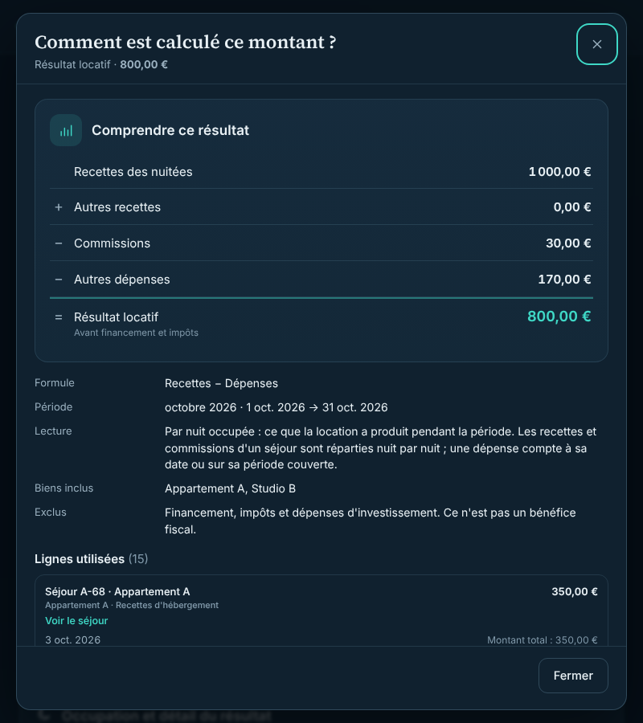</td>
<td width="40%" valign="top">

Un clic sous n'importe quel indicateur ouvre son explication :

- l'**équation** : Recettes − Dépenses = Solde ;
- la **formule**, la **période**, la **lecture** et les **biens inclus** ;
- ce qui est **exclu**, et pourquoi ;
- **toutes les lignes utilisées**, avec la règle appliquée à chacune — « Réparti nuit par nuit sur le séjour », « Compté à sa date »… — et le total.

Pas de boîte noire : vous pouvez refaire chaque calcul à la main.

</td>
</tr>
</table>

---

## 📅 Les séjours, de la réservation au versement

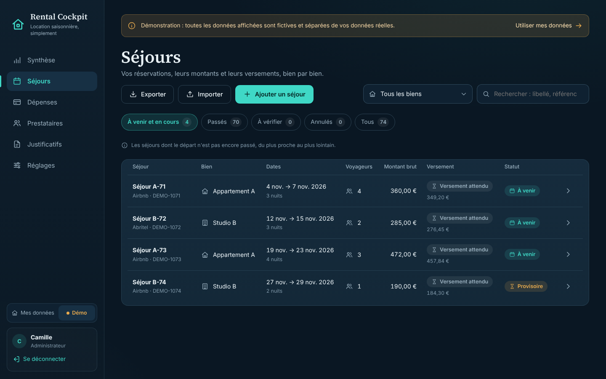

<table>
<tr>
<td width="55%" valign="top">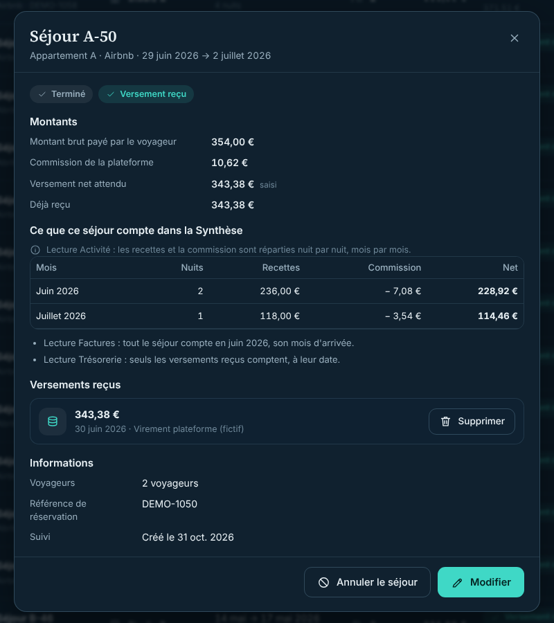</td>
<td width="45%" valign="top">

- **Saisie guidée** : bien, dates (les nuits par mois s'affichent tout de suite), canal de réservation, montant brut et commission ; le versement net attendu se calcule seul.
- **Taxe de séjour et caution** notées à part : jamais comptées comme recettes.
- **Fiche séjour** : ce qui est reçu, ce qui reste à recevoir, et **ce que le séjour compte dans la Synthèse**, mois par mois.
- **Versement reçu** en un clic : la lecture Trésorerie se met à jour.
- **Annulation** avec le montant conservé, compté à la date d'arrivée ; **Rétablir** remet tout.
- Statuts explicites : *À venir*, *En cours*, *Terminé*, *Provisoire*, *Annulé* ; *Versement attendu*, *à confirmer*, *reçu*.

</td>
</tr>
</table>

---

## 📥 Import Airbnb et CSV, vérifié avant d'écrire

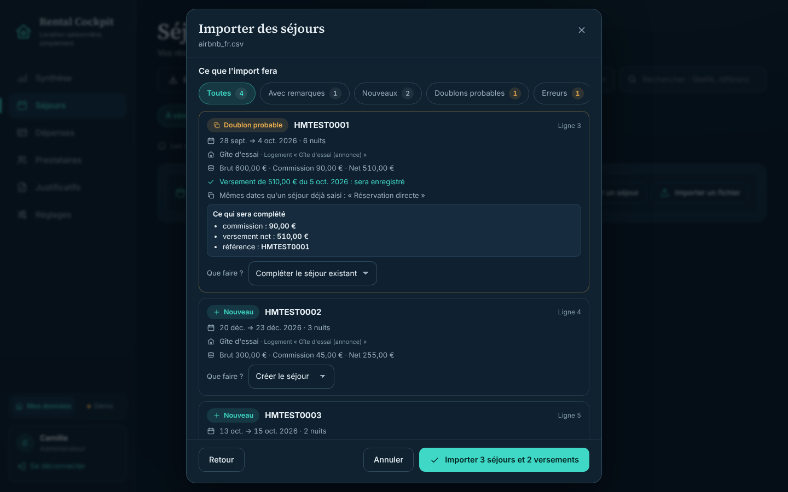

<table>
<tr>
<td width="38%" valign="top">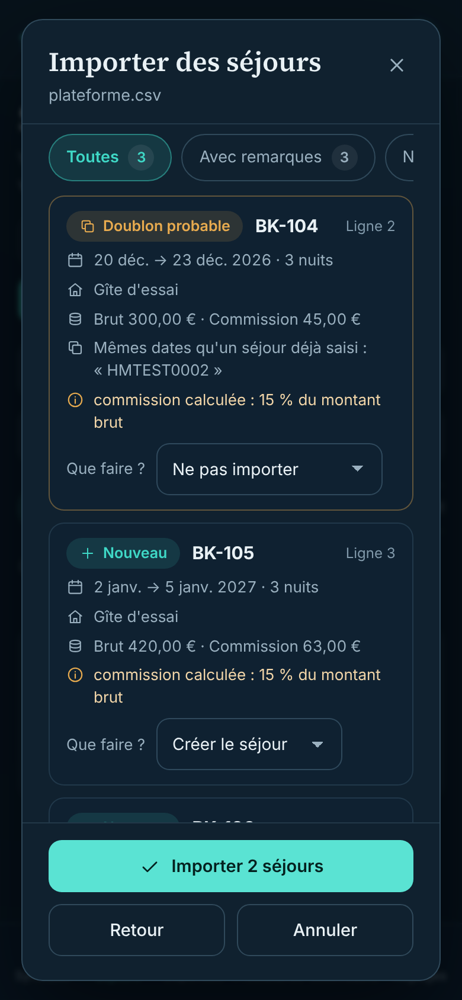</td>
<td width="62%" valign="top">

- **Export Airbnb** (« Historique des transactions », en français) ou **n'importe quel CSV** : Booking.com, Abritel, tableur.
- **Rien n'est écrit avant votre confirmation** : chaque ligne dit ce qui se passera — *Nouveau*, *Mis à jour* (champ par champ), *Doublon probable*, *Déjà à jour*, *Erreur*.
- **Doublons détectés** : même référence, ou mêmes dates qu'un séjour saisi à la main ; vous choisissez de le compléter, d'en créer un autre ou d'ignorer la ligne.
- **Commissions** lues dans le fichier, ou calculées d'après le taux de la plateforme, au centime.
- **Contrôles** : dates illisibles, nuits qui ne correspondent pas, chevauchements, dates indisponibles, montants négatifs, versement supérieur à l'attendu.
- **Versements** datés enregistrés une seule fois ; les virements Airbnb ne sont jamais comptés deux fois.
- **Colonnes et biens mémorisés** pour le fichier suivant ; **annulation** du dernier import en un clic.

</td>
</tr>
</table>

---

## 💳 Dépenses et règlements, sans rien supposer payé

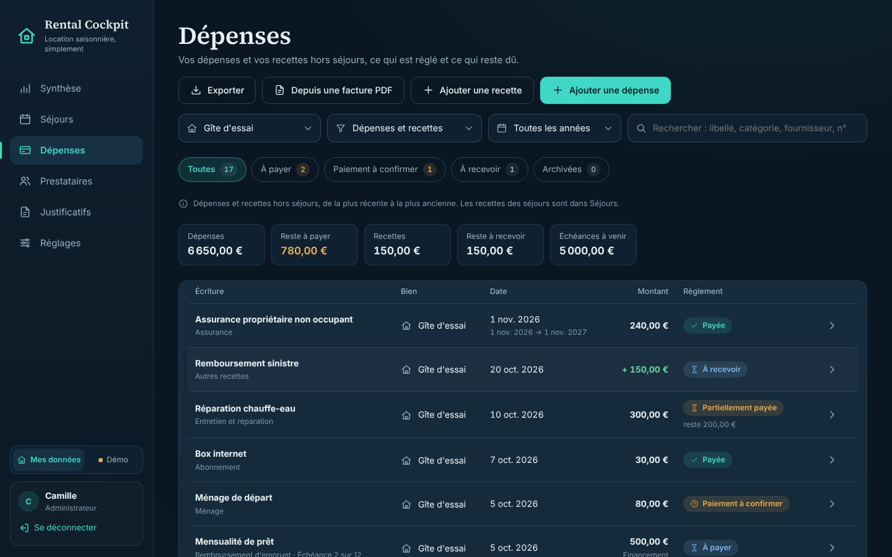

<table>
<tr>
<td width="38%" valign="top">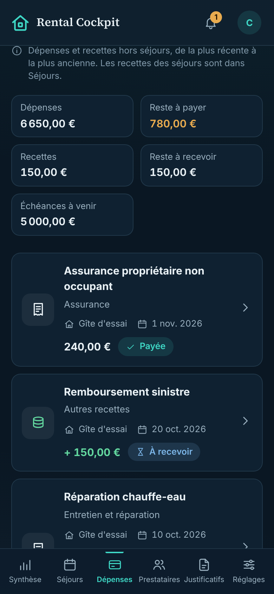</td>
<td width="62%" valign="top">

- **Dépenses et recettes hors séjours** : ménage, réparations, assurance, abonnements, remboursements… chacune dans une catégorie dont le **traitement** est annoncé (exploitation, investissement, financement, impôts).
- **Règlement explicite** : *Payée*, *Partiellement payée*, *À payer* ou *Paiement à confirmer* — rien n'est supposé payé.
- **Paiements partiels**, jamais au-delà du reste dû ; la Trésorerie compte chaque paiement à sa date.
- **Mensualités d'emprunt** : capital, intérêts et assurance vérifiés au centime, hors solde d'exploitation ; **répétition mensuelle** jusqu'à 36 mois, les échéances futures restant *À venir*.
- **Période couverte** : une assurance annuelle est répartie jour par jour dans la lecture Activité.
- **Catégories** personnalisables dans Réglages ; **export CSV** prêt pour un tableur ou un comptable.

</td>
</tr>
</table>


---

## 🧹 Prestataires : une facture détaillée, comptée une fois

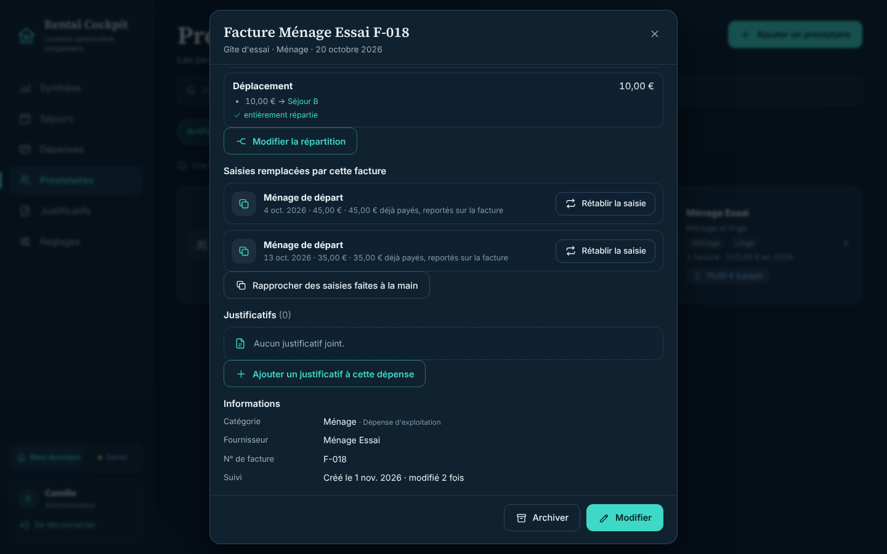

<table>
<tr>
<td width="38%" valign="top">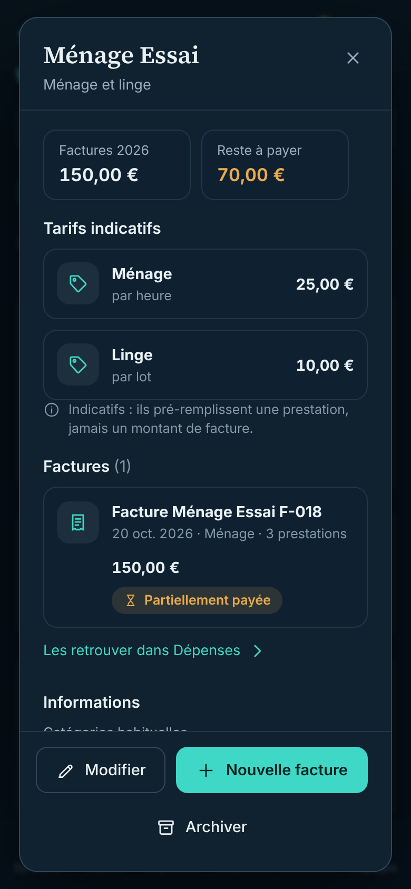</td>
<td width="62%" valign="top">

- **Prestataires** avec leurs catégories habituelles, leur contact et des **tarifs indicatifs** qui pré-remplissent une prestation sans jamais imposer un montant.
- **Facture détaillée** : ménage, linge, déplacement, remise, ajustement justifié… le total des lignes doit égaler la facture, vérifié en direct.
- **Répartition entre les séjours** : chaque prestation va au séjour dont le départ tombe le jour de l'intervention, modifiable ; c'est une analyse, la facture reste **une seule dépense**.
- **Rapprochement** avec les ménages saisis à la main après chaque départ : ils sortent des totaux, leurs paiements passent sur la facture — rien n'est compté deux fois, et c'est réversible.
- **Coûts et marge de chaque séjour** : versement net attendu moins les coûts qui lui sont affectés.

</td>
</tr>
</table>

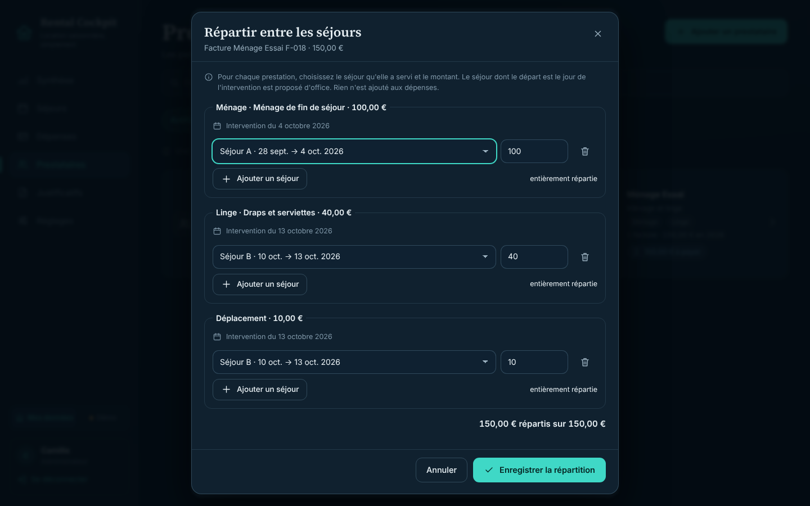

---

## 📎 Justificatifs PDF, privés et vérifiés

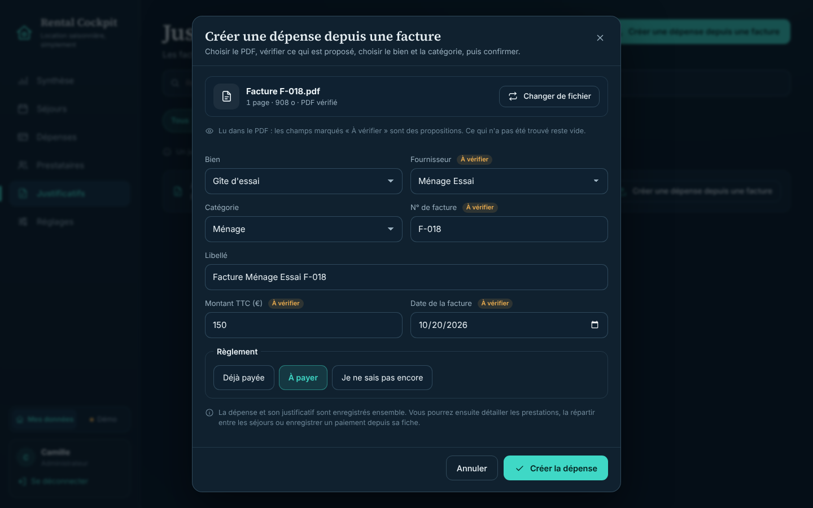

<table>
<tr>
<td width="38%" valign="top">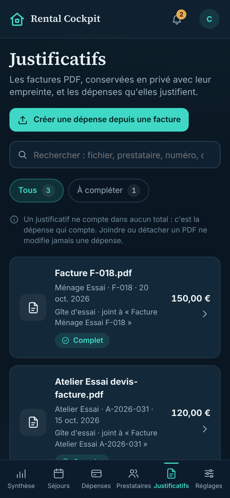</td>
<td width="62%" valign="top">

- **Créer une dépense depuis une facture** : le PDF est lu, la date, le montant TTC, le numéro et le prestataire sont **proposés**, marqués « À vérifier ». Rien n'est deviné, rien n'est enregistré avant votre confirmation.
- **Ajouter un justificatif à une dépense** : la dépense ne change pas. Détacher non plus.
- **Fichier vérifié, jamais exécuté** : vrai PDF, 8 Mio au plus, ni mot de passe, ni script, ni fichier intégré.
- **Doublons** : le même fichier, même renommé, ou la même référence chez le même prestataire est refusé, avec un lien vers la dépense existante. Un montant seul ne suffit jamais.
- **Stockage privé** sous l'empreinte SHA-256, consultation et téléchargement seulement après contrôle des droits — l'accès aux PDF d'un bien s'accorde à part.

</td>
</tr>
</table>

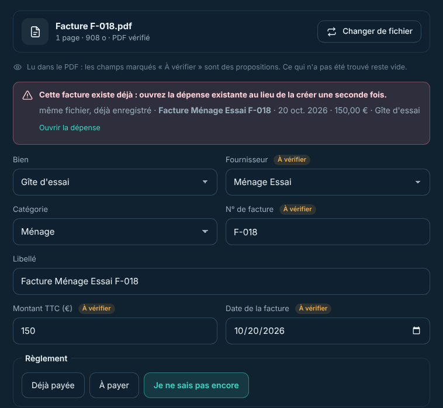

---

## 🔀 Même mois, plusieurs questions

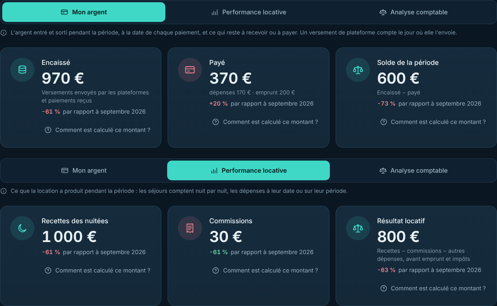

<sub>En haut, la lecture Activité ; en bas, la Trésorerie du même mois : 970 € réellement reçus, la commission de 30 € étant déjà déduite du versement.</sub>

| Lecture | La question | La règle |
|---|---|---|
| **Activité** | Qu'a produit la location pendant la période ? | Un séjour est réparti nuit par nuit ; une dépense compte à sa date ou sur la période qu'elle couvre |
| **Factures** | Quels documents sont datés de la période ? | Chaque facture à sa date, chaque séjour à sa date d'arrivée |
| **Trésorerie** | Quel argent est réellement entré ou sorti ? | Uniquement les paiements, à leur date |

Les pourcentages comparent toujours la période à la précédente, **calculée avec les mêmes règles**.

### Un exemple que vous pouvez vérifier

Il est reproduit à l'identique dans le mois d'exemple de la démonstration :

```text
   1 000 €   recettes du séjour
 −    30 €   commission de la plateforme
 −    80 €   ménage
 −    20 €   linge
 −    10 €   déplacement
 −    60 €   réparation
 ──────────
     800 €   solde avant financement
 −   200 €   mensualité du crédit
 ──────────
     600 €   trésorerie après financement
```

### Les règles qui ne bougent pas

- Les montants sont stockés en **centimes entiers** : aucun arrondi flottant, les totaux se rapprochent au centime.
- Un séjour du 10 au 12 juin compte **deux nuits** : le jour du départ n'est pas une nuit.
- Une valeur inconnue n'est **jamais affichée comme zéro** : le résultat est signalé incomplet.
- Une échéance, la mention « paiement comptant » ou un PDF **ne valent pas paiement**.
- Une facture répartie entre plusieurs séjours reste **une seule dépense**.
- Le *solde avant financement* exclut emprunt, impôts et investissements : ce n'est **pas un bénéfice fiscal**.

📖 [Toutes les règles de calcul](docs/fr/calculs.md)

---

## 📱 Ordinateur, tablette, téléphone

<table>
<tr>
<td width="46%" valign="top"></td>
<td width="27%" valign="top">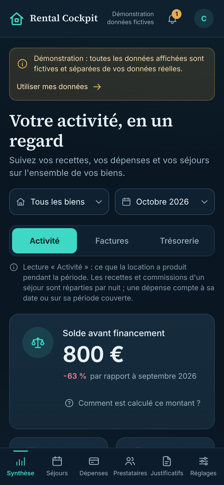</td>
<td width="27%" valign="top">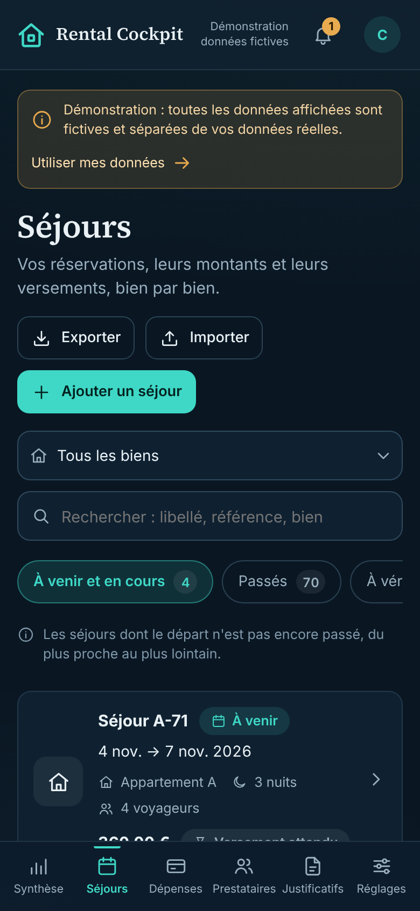</td>
</tr>
<tr>
<td align="center"><b>Sur tablette</b></td>
<td align="center"><b>Sur téléphone</b></td>
<td align="center"><b>Les séjours, au pouce</b></td>
</tr>
</table>

Barre latérale sur grand écran, onglets en haut sur tablette, barre en bas sur téléphone. Sur écran tactile, chaque commande vise 44 × 44 pixels.

---

## 🎮 Démarrer en deux minutes

<table>
<tr>
<td width="50%" valign="top"></td>
<td width="50%" valign="top">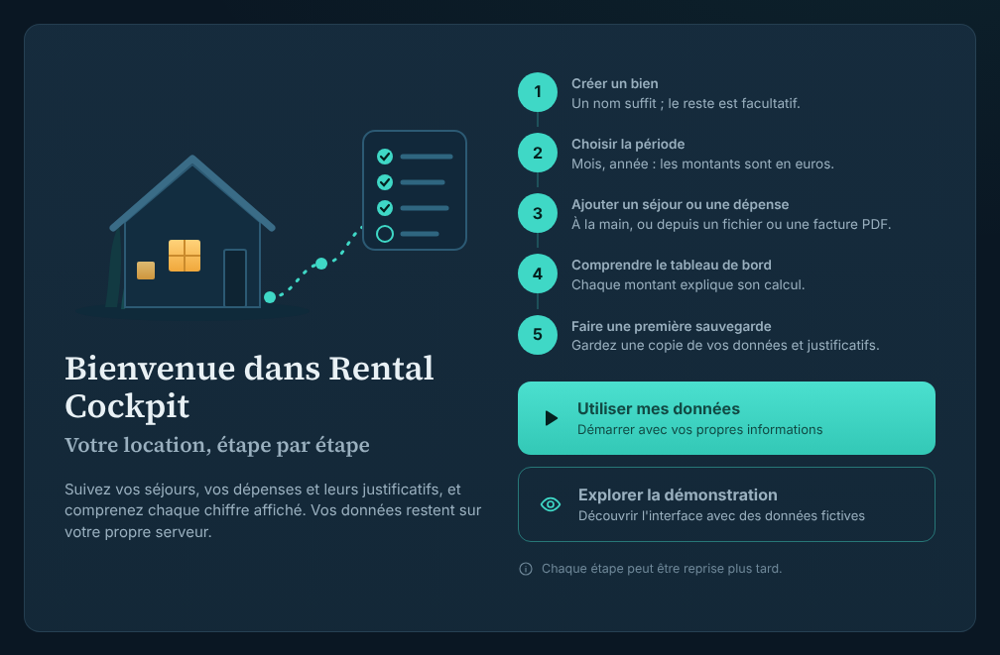</td>
</tr>
<tr>
<td align="center"><b>1. Le compte administrateur</b><br><sub>Aucun compte par défaut : la première visite le crée.</sub></td>
<td align="center"><b>2. Vos données ou la démonstration</b><br><sub>Deux choix explicites, chacun réversible.</sub></td>
</tr>
</table>

Avec la démonstration, tout est déjà rempli : un bandeau permanent rappelle que les chiffres sont fictifs. Avec vos données, vous partez d'un espace vide et créez votre premier bien — seul le nom est obligatoire. La bascule **Mes données / Démo** permet de passer de l'un à l'autre à tout moment.

📖 [Guide de démarrage : les dix premières minutes](docs/fr/guide.md)

---

## 🏠 Home Assistant, en option

Rental Cockpit n'a **pas besoin** de Home Assistant. Mais si vous l'utilisez, une clé en lecture seule suffit pour afficher vos chiffres et déclencher des automatisations, avec l'intégration RESTful déjà incluse : rien à installer.

```yaml
rest:
  - resource: http://rental-cockpit.lan:8080/api/v1/summary?lang=fr
    headers:
      Authorization: !secret rental_cockpit_authorization
    scan_interval: 900
    sensor:
      - name: Location solde du mois
        value_template: "{{ value_json.month.balance_before_financing }}"
        unit_of_measurement: "EUR"
        device_class: monetary
    binary_sensor:
      - name: Location arrivée demain
        value_template: "{{ value_json.properties | selectattr('arrival_tomorrow') | list | count > 0 }}"
```

Et ensuite : **chauffer le logement la veille d'une arrivée**, être prévenu quand un paiement est à confirmer, afficher l'occupation du soir sur votre tableau de bord…

- La clé lit **ce que son compte peut lire** et ne peut **rien modifier**.
- Elle est affichée une seule fois, conservée sous forme d'empreinte et révocable à tout moment.

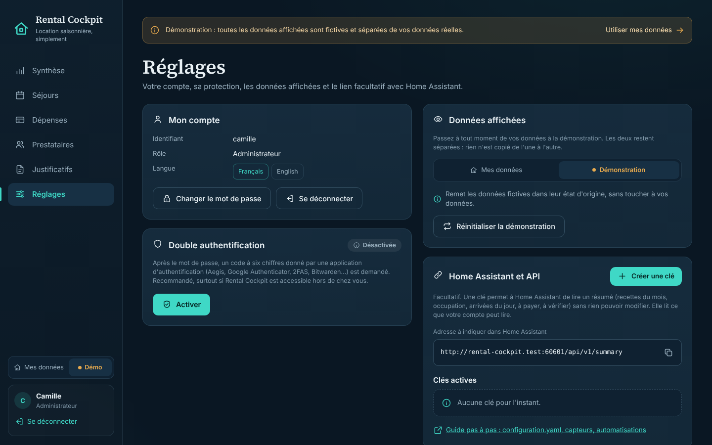

📖 [Guide Home Assistant : capteurs, carte, automatisations, référence de l'API](docs/fr/home-assistant.md)

---

## 📦 Installation

Une image prête à l'emploi est publiée pour **x86-64 et ARM64** (Raspberry Pi 4 compris). Pas besoin de Python ni de cloner le dépôt :

```bash
mkdir rental-cockpit && cd rental-cockpit
curl -fsSLO https://raw.githubusercontent.com/vinzgithub/rental-cockpit/main/docker-compose.yml
docker compose up -d
```

Ouvrez `http://<adresse-de-la-machine>:8080`, créez le compte administrateur, puis explorez la démonstration ou commencez avec vos biens.

Mise à jour : `docker compose pull && docker compose up -d`.

| Image | Pour |
|---|---|
| `ghcr.io/vinzgithub/rental-cockpit:latest` | La dernière version publiée |
| `ghcr.io/vinzgithub/rental-cockpit:0.1` | Rester sur les versions 0.1.x |
| `ghcr.io/vinzgithub/rental-cockpit:edge` | Essayer ce qui arrive (branche principale) |

> [!WARNING]
> Rental Cockpit contient vos données financières. Gardez-le sur votre réseau local ou derrière un VPN, et sauvegardez le volume `/data`.

📖 [Guide complet : Docker, Python, variables, sauvegarde, dépannage du compte](docs/fr/installation.md)

---

## 🔒 Sécurisé par défaut

- Pas de compte par défaut : la première visite crée l'administrateur
- Mots de passe hachés avec scrypt, verrouillage après cinq échecs, jeton anti-CSRF sur chaque modification
- Double authentification en option : code TOTP après le mot de passe, codes de secours à usage unique
- Droits vérifiés sur le serveur à chaque requête : un lecteur ne voit que les biens qui lui sont accordés
- Politique de sécurité du contenu stricte : aucun script, police ou traceur externe — Rental Cockpit n'appelle jamais Internet
- Clés d'API en lecture seule, affichées une seule fois et conservées sous forme d'empreinte
- Imports vérifiés avant écriture ; exports CSV protégés contre l'injection de formules
- Conteneur sans privilège, système de fichiers en lecture seule

<table>
<tr>
<td width="65%" valign="top">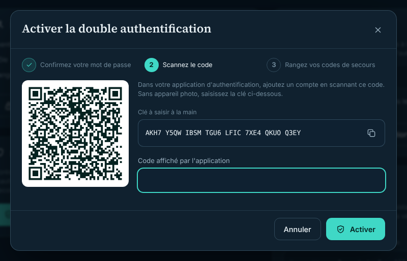</td>
<td width="35%" valign="top">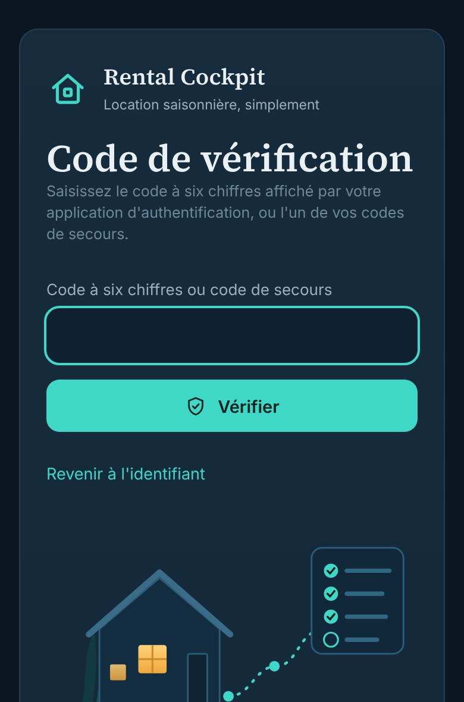</td>
</tr>
<tr>
<td align="center"><b>La double authentification en un scan</b></td>
<td align="center"><b>Le code demandé après le mot de passe</b></td>
</tr>
</table>

📖 [Sécurité et protection des données](docs/fr/securite.md) · [Signaler une vulnérabilité](SECURITY.md)

---

## 💾 Vos données

Tout tient dans **un seul dossier**, `/data` : une base SQLite, vos justificatifs PDF privés et vos sauvegardes. La démonstration vit dans son propre registre et ne se mélange jamais à vos données réelles. Aucune télémétrie, aucun compte chez un éditeur, aucun appel sortant.

**Réglages → Sauvegarde et restauration** crée un fichier ZIP vérifié. Il contient vos biens, séjours, dépenses, PDF et les droits des lecteurs, jamais un mot de passe. La restauration est d'abord contrôlée dans une copie de recette, puis appliquée après confirmation ; vos données du moment sont sauvegardées juste avant. Tout est expliqué dans [docs/fr/sauvegarde.md](docs/fr/sauvegarde.md).

---

## 🗺️ Feuille de route

| | Étape | Contenu |
|:--:|---|---|
| ✅ | **0.1.0** | Synthèse, trois lectures, indicateurs expliqués, démonstration, comptes et droits, double authentification, lien Home Assistant, images Docker |
| ✅ | **0.1.1** | Corrections de l'audit indépendant : menu sans écran vide, bascule Mes données / Démo, explications lisibles sur téléphone |
| ✅ | **0.2.0** | Séjours : saisie, annulation et rétablissement, versements reçus, part de chaque séjour dans la Synthèse |
| ✅ | **0.3.0** | Import Airbnb et CSV : aperçu sans écriture, doublons, commissions, contrôles, annulation du dernier import |
| ✅ | **0.4.0** | Dépenses et règlements : paiements partiels, à payer / à recevoir, mensualités d'emprunt, catégories, export CSV |
| ✅ | **0.5.0** | Prestataires : tarifs indicatifs, factures détaillées réparties entre les séjours, rapprochement, marge par séjour |
| ✅ | **0.6.0** | Justificatifs PDF : contrôlés, privés, doublons détectés, joints aux dépenses ou à l'origine d'une dépense |
| ✅ | **1.0** | Sauvegarde et restauration vérifiées, comptes lecteurs, accessibilité, performances, recette complète — en recette avant publication stable |

📖 [Feuille de route détaillée](docs/fr/feuille-de-route.md)

---

## 📚 Documentation

| Document | Contenu |
|---|---|
| [Installation](docs/fr/installation.md) | Image Docker, Python, variables, mise à jour, dépannage du compte |
| [Sauvegarde et restauration](docs/fr/sauvegarde.md) | Contenu d'une sauvegarde, restauration vérifiée, ligne de commande, après une mise à jour ratée |
| [Guide](docs/fr/guide.md) | De la démonstration à l'usage quotidien : séjours, dépenses, prestataires, justificatifs, lecteurs, sauvegarde |
| [Règles de calcul](docs/fr/calculs.md) | Les trois lectures, chaque indicateur, glossaire |
| [Home Assistant](docs/fr/home-assistant.md) | Lien facultatif : capteurs, automatisations, carte, référence de l'API |
| [Sécurité](docs/fr/securite.md) | Comptes, double authentification, droits, clés d'API, données, exposition réseau |
| [Architecture et adaptations](docs/fr/architecture-et-adaptations.md) | Ce qui est repris du projet d'origine, ce qui change avec une application autonome |
| [Recette de la 1.0](docs/fr/recette.md) | Chaque critère de publication et ce qui le vérifie, mesures de performance, limites connues |
| [Feuille de route](docs/fr/feuille-de-route.md) | Livraisons et suites prévues |
| [Journal des modifications](CHANGELOG.md) | Le contenu de chaque version |

---

## 🛡️ Licence et droits d'auteur

**Copyright © 2026 Vincent Fournet.**

La licence est **à définir**. Aucune licence n'est encore accordée sur ce code : tant qu'une licence n'est pas publiée dans ce dépôt, les droits d'auteur s'appliquent par défaut.

Les polices incluses (Source Serif 4 et Inter) sont distribuées sous SIL Open Font License 1.1 : voir [THIRD_PARTY_NOTICES.md](THIRD_PARTY_NOTICES.md).

---

## ℹ️ Avertissement

Rental Cockpit est un outil de suivi, pas un logiciel de comptabilité ni un conseil fiscal : le solde avant financement n'est pas un bénéfice imposable, et Rental Cockpit ne remplace ni votre déclaration ni un expert-comptable.

Les chiffres des captures et de la documentation viennent de la démonstration fictive fournie avec l'application.

Airbnb, Abritel, Home Assistant et les autres noms de produits ou de sociétés cités restent la propriété de leurs détenteurs. Rental Cockpit n'est affilié à aucune de ces sociétés.

---

<div align="center">

### 🏡 Rental Cockpit

**Chaque euro de votre location, expliqué.**

Copyright © 2026 Vincent Fournet

</div>
