<div align="center">

# 🏡 Rental Cockpit

### Your holiday let, every figure explained

**My money · Rental performance · Stays · Airbnb and CSV import · Expenses and payments · Explained indicators · To check · Two-factor sign-in · Home Assistant**

[**Français**](README.fr.md) · **English**

  

<br>

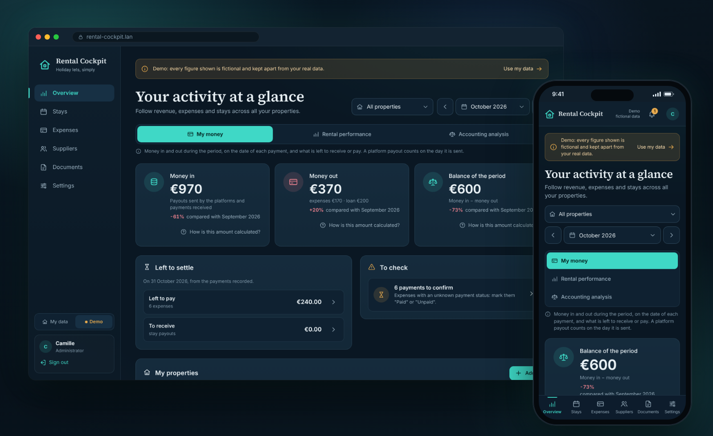

<sub>The screenshots show the built-in demo: two fictional properties, "Démo" suppliers and invented amounts.</sub>

<br><br>

**Self-hosted · Local-first · Bilingual (FR / EN) · No outside service**

</div>

---

## 🚀 At a glance

<table>
<tr>
<td width="33%" valign="top"><b>🧾 Every figure explains itself</b><br>Under each amount, "How is this amount calculated?": formula, period, exclusions and every line used.</td>
<td width="33%" valign="top"><b>💶 My money, first</b><br>What came in, what went out, what is left to receive or pay. Rental performance and accounting analysis are one click away.</td>
<td width="33%" valign="top"><b>✅ What is left to check</b><br>Unknown payments, stays without an amount, payouts not received: an incomplete result is flagged, never disguised as zero.</td>
</tr>
<tr>
<td valign="top"><b>📅 Complete stays</b><br>Entered by hand or imported from Airbnb or a CSV after a check; cancelled with the fee retained, payouts followed: each stay shows its share of the Overview.</td>
<td valign="top"><b>🔐 Two-factor sign-in</b><br>A code from an authenticator app after the password, and ten single-use recovery codes.</td>
<td valign="top"><b>🏠 Home Assistant, if you like</b><br>A read-only key: revenue, occupancy, next arrival, and automations such as heating the day before an arrival.</td>
</tr>
</table>

> [!NOTE]
> **Version 1.0.0, under review.** Everything planned for the first version is ready: the Overview (*My money*, *Rental performance*, *Accounting analysis*), **stays** (entry, **Airbnb and CSV import**, cancellation, payouts received), **expenses and payments**, **suppliers** (detailed invoices split between stays, reconciliation), **PDF documents**, **reader accounts**, **checked backup and restore**, the demo, two-factor sign-in and the Home Assistant link. It becomes the stable version once acceptance is passed ([criteria and results](docs/en/acceptance.md)).

---

## ✨ Why Rental Cockpit?

Renting out a home means juggling platform payouts already cut by the commission, a cleaning invoice covering three stays, a loan instalment, a tax that falls once a year… At the end of the month, one simple question has no clear answer: **what did the rental actually bring in?**

A spreadsheet gives a figure; it does not say where it comes from. Rental Cockpit does the opposite: **every amount shows its calculation**, every incomplete result is flagged, and nothing is ever counted twice.

It grew out of a personal tool for tracking a holiday let and reuses its calculation rules, in a standalone application you run at home. No subscription, no online account: your data stays on your server.

---

## 🧾 "How is this amount calculated?"

<table>
<tr>
<td width="60%" valign="top">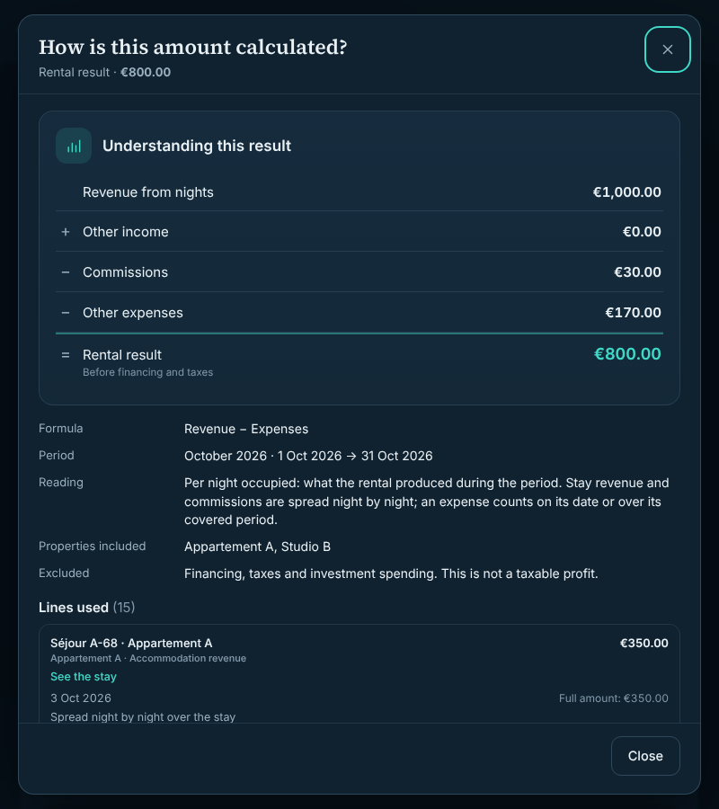</td>
<td width="40%" valign="top">

One click under any indicator opens its explanation:

- the **calculation**: Money in − Money out = Balance, or Revenue − Expenses = Result;
- the **formula**, **period**, **method** and **properties included**;
- what is **excluded**, and why;
- **every line used**, with the rule applied to each — "Spread night by night over the stay", "Counted on its date"… — and the total.

No black box: you can redo every calculation by hand.

</td>
</tr>
</table>

---

## 📅 Stays, from booking to payout

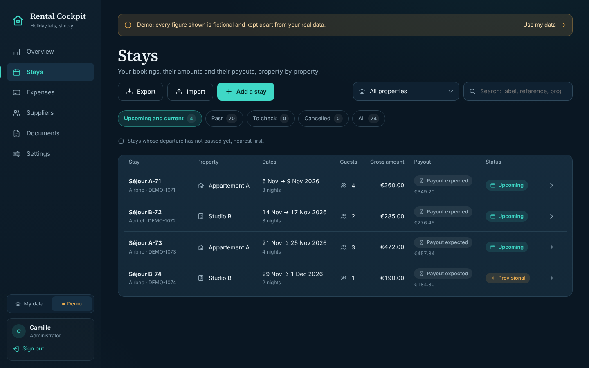

<table>
<tr>
<td width="55%" valign="top">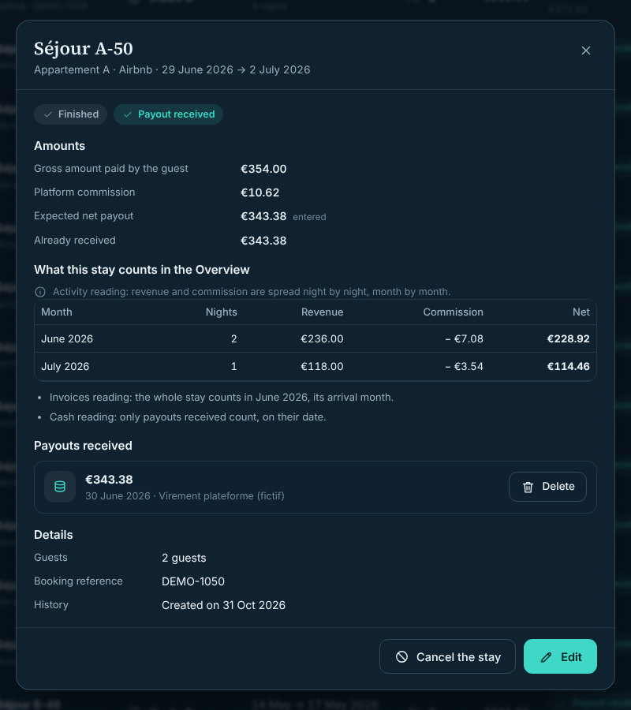</td>
<td width="45%" valign="top">

- **Guided entry**: property, dates (nights per month shown at once), booking channel, gross amount and commission; the expected net payout is computed.
- **Tourist tax and security deposit** recorded apart: never counted as revenue.
- **Stay page**: what was received, what is left to receive, and **what the stay counts in the Overview**, month by month.
- **Payout received** in one click: *My money* updates.
- **Cancellation** with the amount retained, counted on the arrival date; **Restore** brings everything back.
- Explicit statuses: *Upcoming*, *In progress*, *Finished*, *Provisional*, *Cancelled*; *Payout expected*, *to confirm*, *received*.

</td>
</tr>
</table>

---

## 📥 Airbnb and CSV import, checked before writing

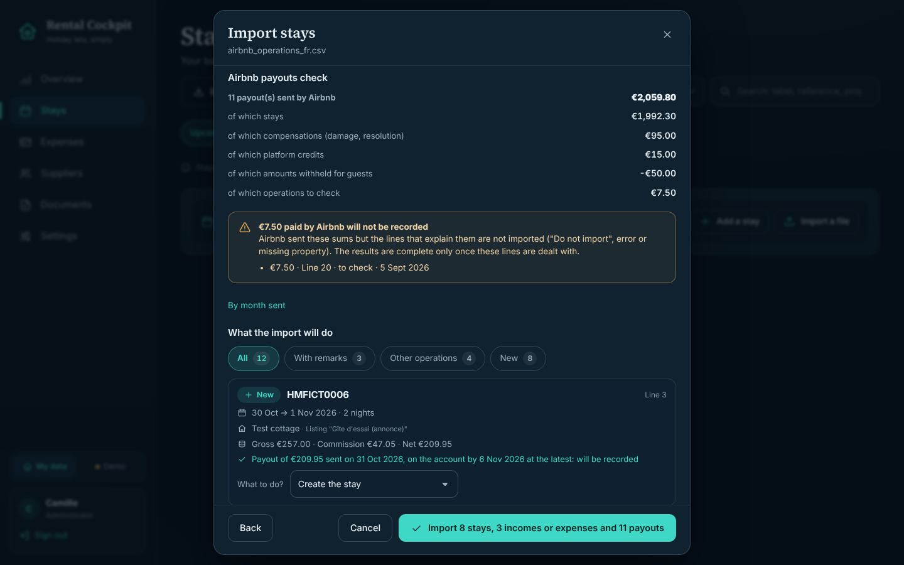

<table>
<tr>
<td width="38%" valign="top">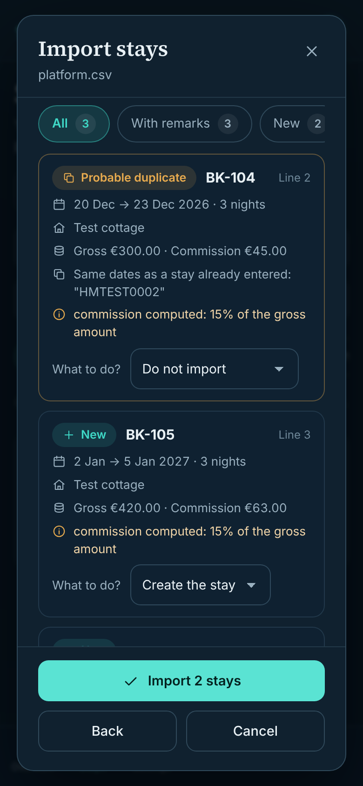</td>
<td width="62%" valign="top">

- **Airbnb export** (French "Historique des transactions") or **any CSV**: Booking.com, Abritel, spreadsheet.
- **Nothing is written before you confirm**: each line says what will happen — *New*, *Updated* (field by field), *Probable duplicate*, *Up to date*, *Error*.
- **Duplicates detected**: same reference, or same dates as a stay entered by hand; you choose to complete it, create another one or skip the line.
- **Commissions** read from the file, or computed from the platform's rate, to the cent.
- **Checks**: unreadable dates, nights that do not match, overlaps, unavailable dates, negative amounts, payout above what is expected.
- **Each Airbnb payout matched to the cent** with the lines it pays, with the date it reaches the account; never counted twice.
- **AirCover compensations, credits and amounts withheld** read and classified; an unknown type is shown with its amount, never dropped in silence.
- **Booking cancelled but paid**: the money counts, the nights do not.
- **Payouts check** before importing: by kind and by month, with what would not be recorded.
- **Columns and properties remembered** for the next file; the last import can be **undone** in one click.

</td>
</tr>
</table>

---

## 💳 Expenses and payments, nothing assumed paid

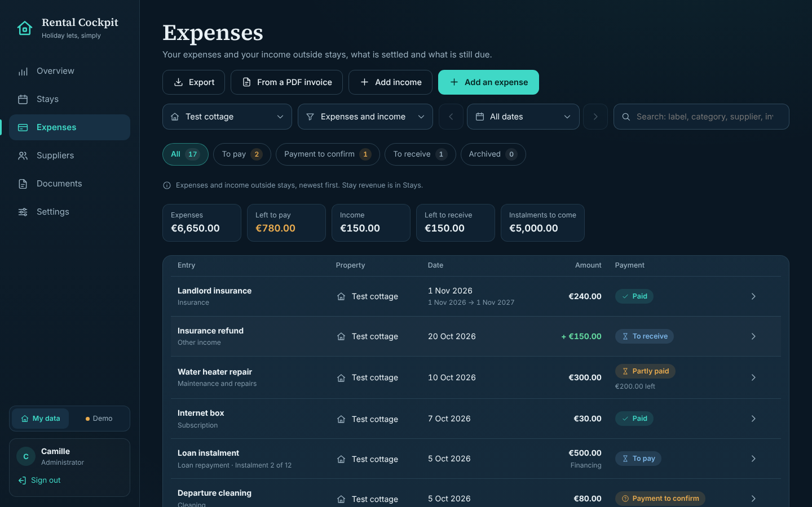

<table>
<tr>
<td width="38%" valign="top">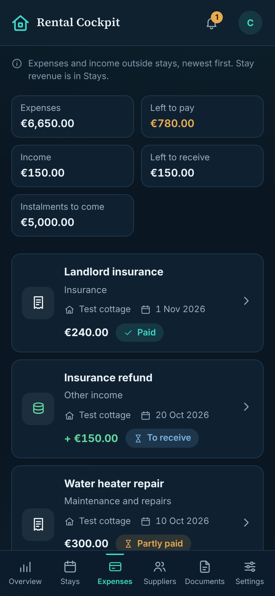</td>
<td width="62%" valign="top">

- **Expenses and income outside stays**: cleaning, repairs, insurance, subscriptions, refunds… each in a category whose **treatment** is stated (operations, investment, financing, taxes).
- **Explicit payment status**: *Paid*, *Partly paid*, *To pay* or *Payment to confirm* — nothing is assumed paid.
- **Partial payments**, never above what is left; *My money* counts each payment on its date.
- **Loan instalments**: principal, interest and insurance checked to the cent, outside the operating balance; **monthly repetition** up to 36 months, future instalments staying *Coming up*.
- **Period covered**: an annual insurance is spread day by day in *Rental performance*.
- **Categories** you can adapt in Settings; **CSV export** ready for a spreadsheet or an accountant.

</td>
</tr>
</table>

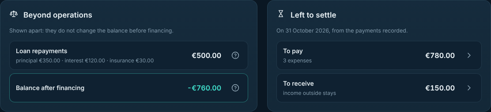

---

## 🧹 Suppliers: a detailed invoice, counted once

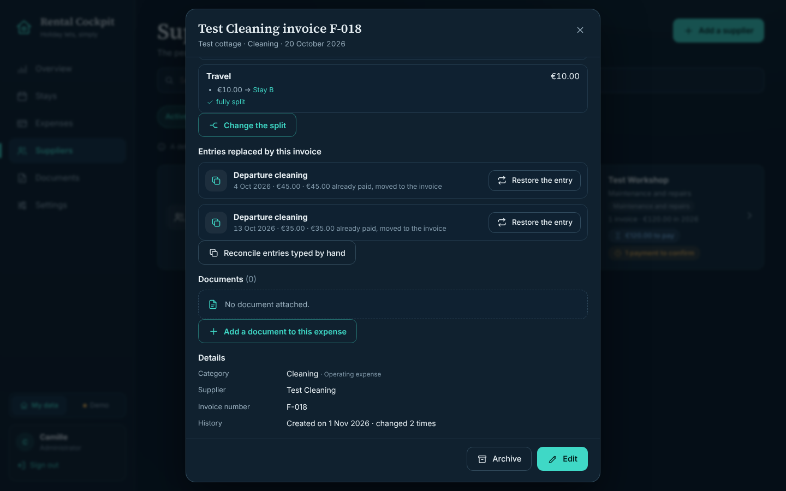

<table>
<tr>
<td width="38%" valign="top">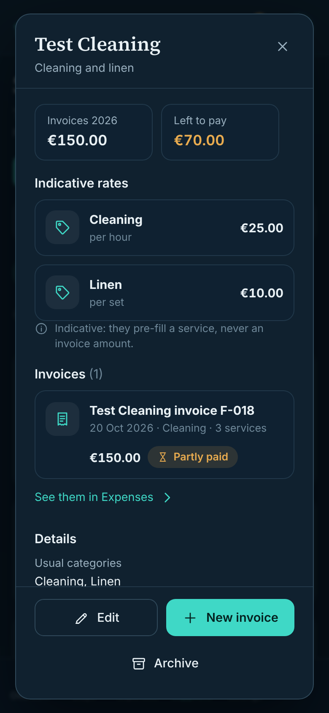</td>
<td width="62%" valign="top">

- **Suppliers** with their usual categories, their contact and **indicative rates** that pre-fill a service without ever forcing an amount.
- **Detailed invoice**: cleaning, linen, travel, discount, justified adjustment… the lines must add up to the invoice, checked live.
- **Split between stays**: each service goes to the stay whose departure falls on the day of the work, which you can change; it is an analysis, the invoice stays **one single expense**.
- **Reconciliation** with the cleanings typed by hand after each departure: they leave the totals and their payments move to the invoice — nothing is counted twice, and it can be undone.
- **Costs and margin of each stay**: expected net payout minus the costs allocated to it.

</td>
</tr>
</table>

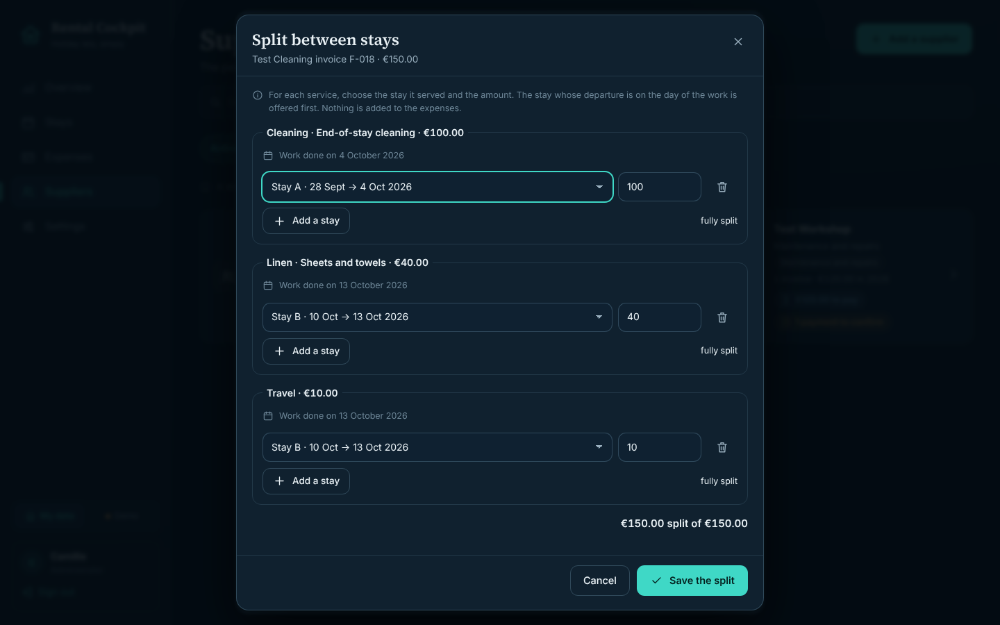

---

## 📎 PDF documents, private and checked

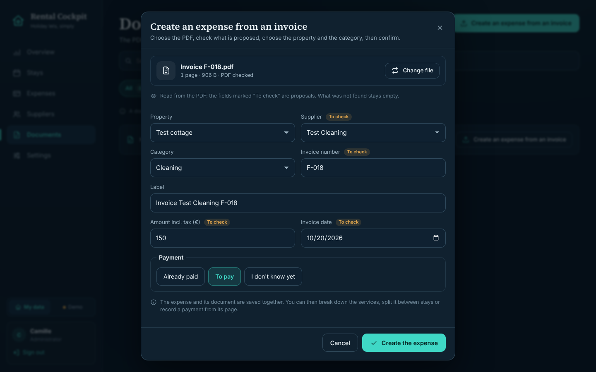

<table>
<tr>
<td width="38%" valign="top">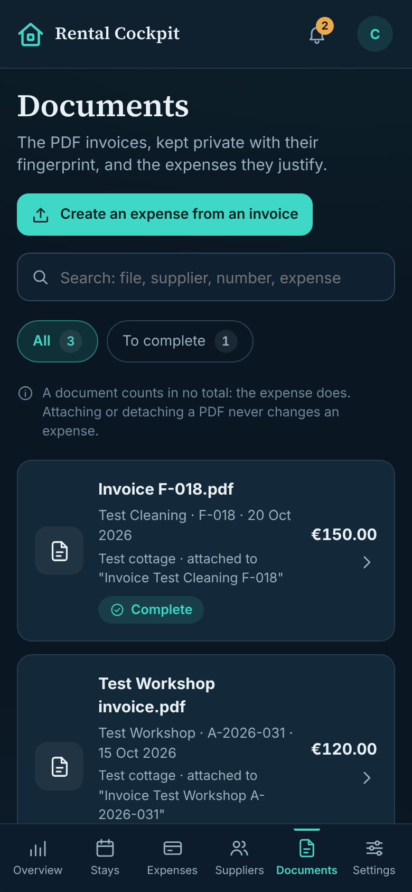</td>
<td width="62%" valign="top">

- **Create an expense from an invoice**: the PDF is read, and the date, amount including tax, number and supplier are **proposed**, marked "To check". Nothing is guessed, nothing is saved before you confirm.
- **Add a document to an expense**: the expense does not change. Detaching does not change it either.
- **File checked, never run**: a real PDF, 8 MiB at most, no password, no script, no embedded file.
- **Duplicates**: the same file, even renamed, or the same reference from the same supplier is refused, with a link to the existing expense. An amount alone is never enough.
- **Private storage** under the SHA-256 fingerprint, viewing and download only after a rights check — access to a property's PDFs is granted separately.

</td>
</tr>
</table>

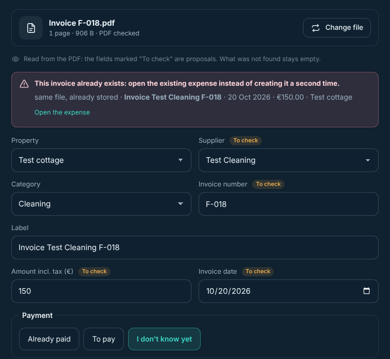

---

## 🔀 Same month, three views

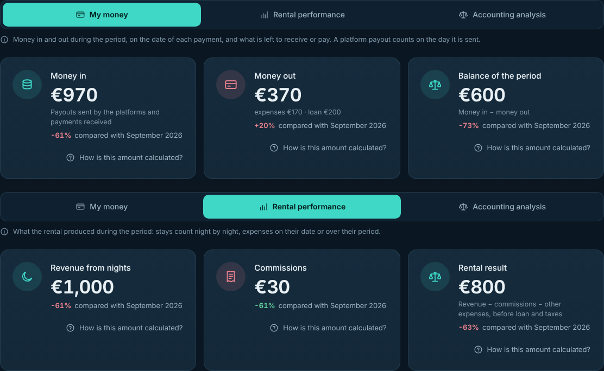

<sub>Top, *My money*: €970 in, the €30 commission being already withheld by the platform. Bottom, *Rental performance* for the same month: €1,000 revenue from nights, €800 rental result.</sub>

| View | The question | The rule |
|---|---|---|
| **My money** (default) | What money came in or went out, what is left to receive or pay? | Payments, on their date; a platform payout on the day it is sent |
| **Rental performance** | What did the rental produce? | A stay is spread night by night; an expense counts on its date or over the period it covers; nights, occupancy, the twelve months of the year |
| **Accounting analysis** | How is each amount tied to a period? | As chosen: per night occupied, by stay or invoice date, by payment date |

Percentages always compare the period with the previous one, **computed with the same rules**. The period is chosen in one gesture: `◀ October 2026 ▶`, the twelve months of a year, the whole year or a free period.

### An example you can check

It is reproduced exactly in the demo's example month:

```text
   €1,000   stay revenue
 −    €30   platform commission
 −    €80   cleaning
 −    €20   linen
 −    €10   travel
 −    €60   repair
 ─────────
     €800   balance before financing
 −   €200   loan instalment
 ─────────
     €600   balance of the period in "My money": €970 in − €370 out
```

### Rules that never move

- Amounts are stored as **whole cents**: no floating-point rounding, totals reconcile to the cent.
- A stay from 10 to 12 June is **two nights**: the departure day is not a night.
- An unknown value is **never shown as zero**: the result is flagged as incomplete.
- A due date, a "paid in cash" mention or an attached PDF **is not a payment**.
- An invoice split between several stays remains **one expense**.
- The *balance before financing* excludes loans, taxes and investments: it is **not a taxable profit**.

📖 [All calculation rules](docs/en/calculations.md)

---

## 📱 Computer, tablet, phone

<table>
<tr>
<td width="46%" valign="top"></td>
<td width="27%" valign="top">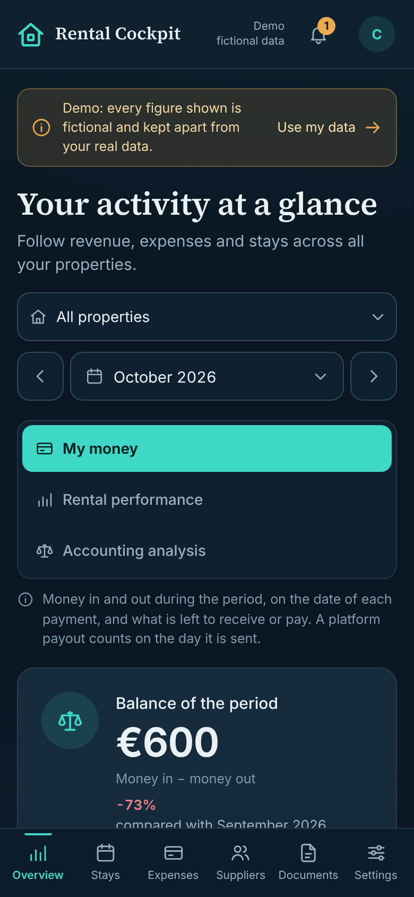</td>
<td width="27%" valign="top">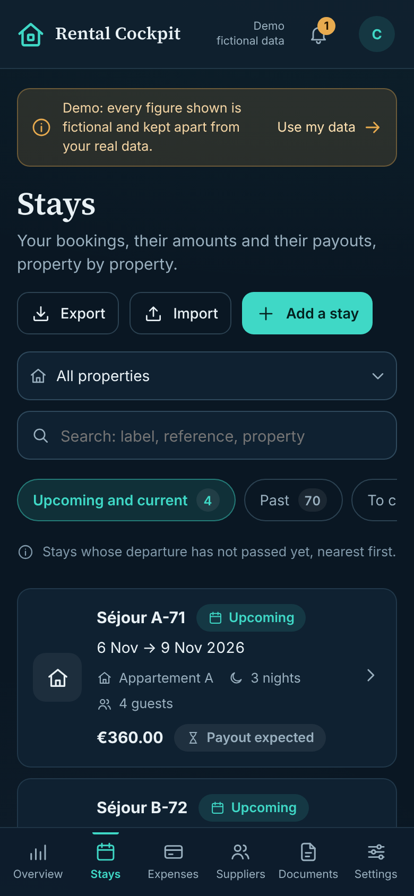</td>
</tr>
<tr>
<td align="center"><b>On a tablet</b></td>
<td align="center"><b>On a phone</b></td>
<td align="center"><b>Stays, thumb-friendly</b></td>
</tr>
</table>

Sidebar on a large screen, top tabs on a tablet, bottom bar on a phone. On touch screens, every control aims at 44 × 44 pixels.

---

## 🎮 Up and running in two minutes

<table>
<tr>
<td width="50%" valign="top">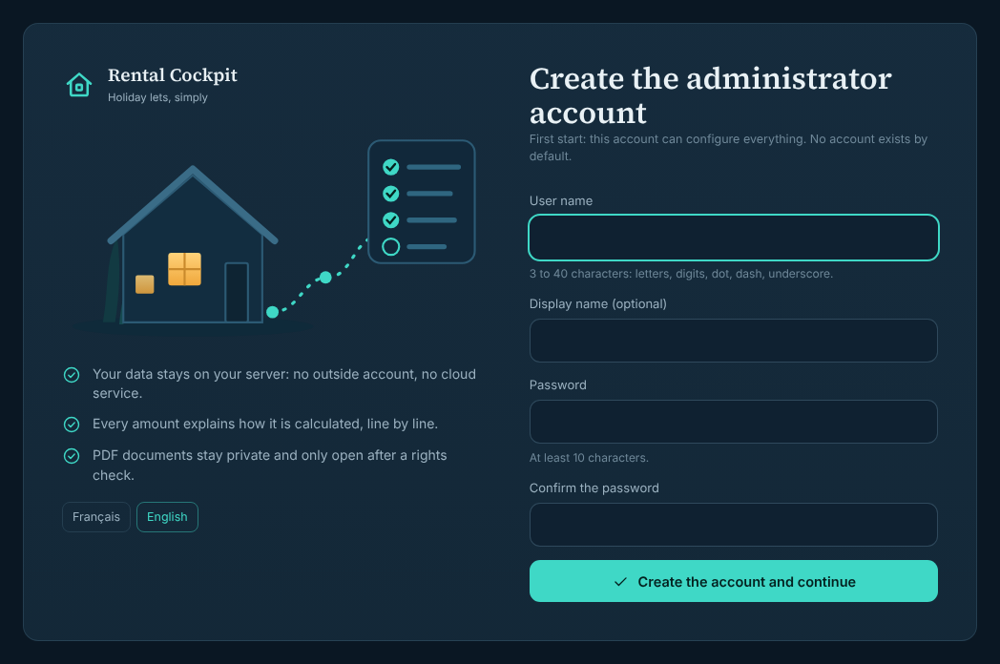</td>
<td width="50%" valign="top">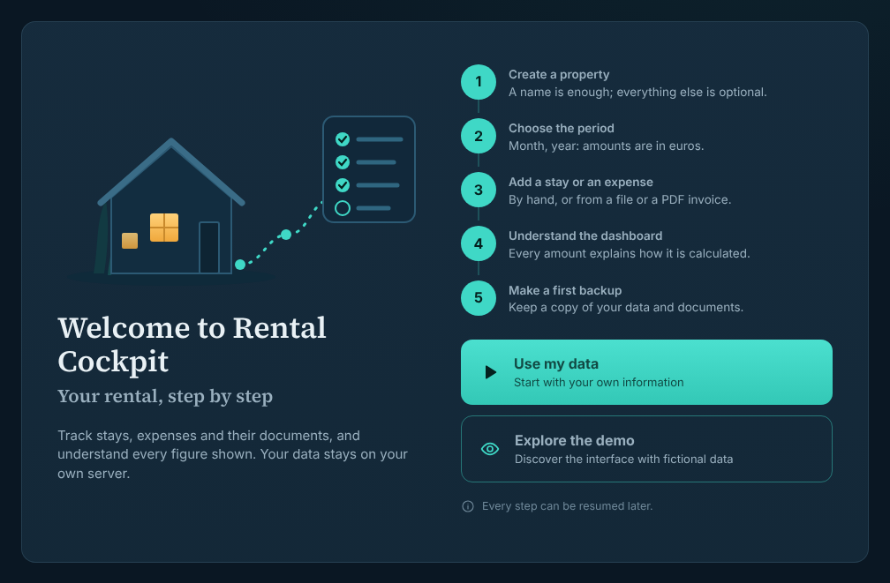</td>
</tr>
<tr>
<td align="center"><b>1. The administrator account</b><br><sub>No default account: the first visit creates it.</sub></td>
<td align="center"><b>2. Your data or the demo</b><br><sub>Two explicit choices, each one reversible.</sub></td>
</tr>
</table>

With the demo, everything is already filled in: a permanent banner reminds you the figures are fictional. With your data, you start from an empty space and create your first property — only the name is required. The **My data / Demo** switch takes you from one to the other at any time.

📖 [Getting started: the first ten minutes](docs/en/guide.md)

---

## 🏠 Home Assistant, as an option

Rental Cockpit does **not need** Home Assistant. But if you use it, a read-only key is enough to show your figures and trigger automations, with the RESTful integration that is already included: nothing to install.

```yaml
rest:
  - resource: http://rental-cockpit.lan:8080/api/v1/summary?lang=en
    headers:
      Authorization: !secret rental_cockpit_authorization
    scan_interval: 900
    sensor:
      - name: Rental month balance
        value_template: "{{ value_json.month.balance_before_financing }}"
        unit_of_measurement: "EUR"
        device_class: monetary
    binary_sensor:
      - name: Rental arrival tomorrow
        value_template: "{{ value_json.properties | selectattr('arrival_tomorrow') | list | count > 0 }}"
```

Then: **heat the home the day before an arrival**, get told when a payment needs confirming, show tonight's occupancy on your dashboard…

- The key reads **what its account can read** and can **change nothing**.
- It is shown once, kept as a hash and can be revoked at any time.

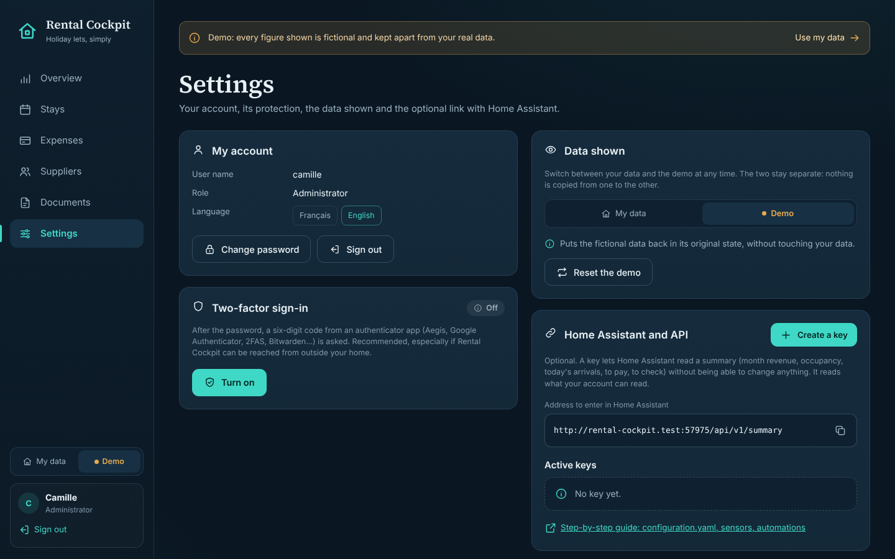

📖 [Home Assistant guide: sensors, card, automations, API reference](docs/en/home-assistant.md)

---

## 📦 Installation

A ready-made image is published for **x86-64 and ARM64** (including Raspberry Pi 4). No Python needed, no need to clone the repository:

```bash
mkdir rental-cockpit && cd rental-cockpit
curl -fsSLO https://raw.githubusercontent.com/vinzgithub/rental-cockpit/main/docker-compose.yml
docker compose up -d
```

Open `http://<machine-address>:8080`, create the administrator account, then explore the demo or start with your properties.

Upgrade: `docker compose pull && docker compose up -d`.

| Image | For |
|---|---|
| `ghcr.io/vinzgithub/rental-cockpit:latest` | The latest released version |
| `ghcr.io/vinzgithub/rental-cockpit:0.1` | Staying on 0.1.x versions |
| `ghcr.io/vinzgithub/rental-cockpit:edge` | Trying what is coming (main branch) |

> [!WARNING]
> Rental Cockpit holds your financial data. Keep it on your local network or behind a VPN, and back up the `/data` volume.

📖 [Full guide: Docker, Python, variables, backup, account recovery](docs/en/installation.md)

---

## 🔒 Secure by default

- No default account: the first visit creates the administrator
- Passwords hashed with scrypt, lock after five failures, anti-CSRF token on every change
- Optional two-factor sign-in: TOTP code after the password, single-use recovery codes
- Rights checked on the server for every request: a reader only sees the properties granted to them
- Strict Content-Security-Policy: no external script, font or tracker — Rental Cockpit never calls the Internet
- Read-only API keys, shown once and kept as a hash
- Imports checked before writing; CSV exports protected against formula injection
- Unprivileged container, read-only filesystem

<table>
<tr>
<td width="65%" valign="top">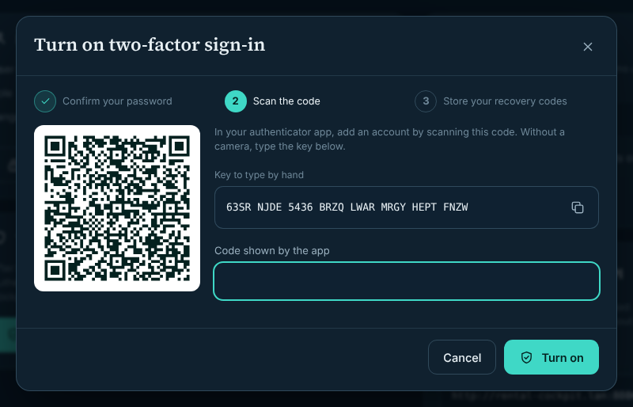</td>
<td width="35%" valign="top">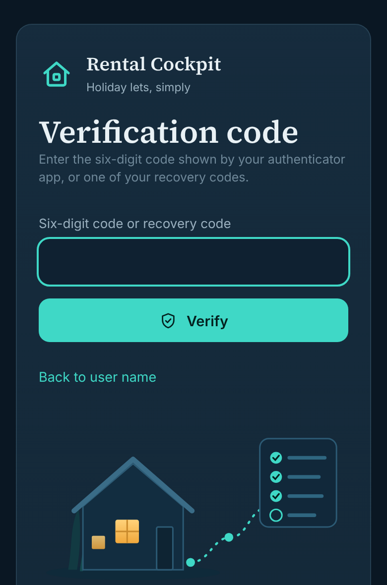</td>
</tr>
<tr>
<td align="center"><b>Two-factor sign-in in one scan</b></td>
<td align="center"><b>The code asked after the password</b></td>
</tr>
</table>

📖 [Security and data protection](docs/en/security.md) · [Report a vulnerability](SECURITY.md)

---

## 💾 Your data

Everything lives in **one folder**, `/data`: an SQLite database, your private PDF documents and your backups. The demo lives in its own registry and never mixes with your real data. No telemetry, no vendor account, no outgoing call.

**Settings → Backup and restore** creates a checked ZIP file. It holds your properties, stays, expenses, PDFs and readers' rights, never a password. A restore is first checked in a test copy, then applied after confirmation; your current data are backed up just before. Everything is explained in [docs/en/backup.md](docs/en/backup.md).

---

## 🗺️ Roadmap

| | Step | Content |
|:--:|---|---|
| ✅ | **0.1.0** | Overview, three readings, explained indicators, demo, accounts and rights, two-factor sign-in, Home Assistant link, Docker images |
| ✅ | **0.1.1** | Fixes from the independent audit: menu without empty screens, My data / Demo switch, explanations readable on a phone |
| ✅ | **0.2.0** | Stays: entry, cancellation and restoration, payouts received, each stay's share of the Overview |
| ✅ | **0.3.0** | Airbnb and CSV import: preview with nothing written, duplicates, commissions, checks, undo of the last import |
| ✅ | **0.4.0** | Expenses and payments: partial payments, to pay / to receive, loan instalments, categories, CSV export |
| ✅ | **0.5.0** | Suppliers: indicative rates, detailed invoices split between stays, reconciliation, margin per stay |
| ✅ | **0.6.0** | PDF documents: checked, private, duplicates detected, attached to expenses or creating one |
| ✅ | **1.0** | Checked backup and restore, reader accounts, accessibility, performance, full acceptance run — under review before the stable release |

📖 [Detailed roadmap](docs/en/roadmap.md)

---

## 📚 Documentation

| Document | Content |
|---|---|
| [Installation](docs/en/installation.md) | Docker image, Python, variables, upgrading, account recovery |
| [Backup and restore](docs/en/backup.md) | What a backup holds, checked restore, command line, after an update that went wrong |
| [Guide](docs/en/guide.md) | From the demo to daily use: stays, expenses, suppliers, documents, readers, backup |
| [Calculation rules](docs/en/calculations.md) | The three views of the Overview, Airbnb operations, each indicator, glossary |
| [Home Assistant](docs/en/home-assistant.md) | Optional link: sensors, automations, card, API reference |
| [Security](docs/en/security.md) | Accounts, two-factor sign-in, rights, API keys, data, network exposure |
| [Architecture and adaptations](docs/en/architecture.md) | What is reused from the original project, what changes with a standalone application |
| [Acceptance of 1.0](docs/en/acceptance.md) | Each release criterion and what checks it, performance measurements, known limits |
| [Roadmap](docs/en/roadmap.md) | Deliveries and what comes next |
| [Changelog](CHANGELOG.md) | What each version contains |

---

## 🛡️ Licence and copyright

**Copyright © 2026 Vincent Fournet.**

The licence is **to be decided**. No licence is granted on this code yet: until a licence is published in this repository, default copyright applies.

The bundled fonts (Source Serif 4 and Inter) are distributed under the SIL Open Font License 1.1: see [THIRD_PARTY_NOTICES.md](THIRD_PARTY_NOTICES.md).

---

## ℹ️ Disclaimer

Rental Cockpit is a tracking tool, not accounting software or tax advice: the balance before financing is not a taxable profit, and Rental Cockpit replaces neither your tax return nor an accountant.

The figures in the screenshots and documentation come from the fictional demo shipped with the application.

Airbnb, Abritel, Home Assistant and the other product or company names mentioned remain the property of their owners. Rental Cockpit is not affiliated with any of these companies.

---

<div align="center">

### 🏡 Rental Cockpit

**Every euro of your rental, explained.**

Copyright © 2026 Vincent Fournet

</div>
