# Getting started — the first ten minutes

This walk-through uses the **demo**: nothing you do here touches your real data.

## 1. Create the administrator account

On first opening, Rental Cockpit asks for a user name and a password (at least 10 characters). This account can configure everything. No account exists by default.

## 2. Choose: your data or the demo

The welcome screen shows the five getting-started steps and two choices:

- **Use my data**: you start empty and create your first property;
- **Explore the demo**: two fictional properties, a year of invented activity.

Every step can be resumed later. Choose the demo.

## 3. Read the Overview

A banner permanently reminds you that the data is fictional. The period offered is the demo's **example month**, which reproduces the documentation example:

- Revenue **€1,000**, Expenses **€200**, Balance before financing **€800**;
- Appartement A: €600 / €120 / €480; Studio B: €400 / €80 / €320.

Under each amount, the percentage compares with the previous month, which is ordinary fictional activity.

## 4. Change the reading

At the top, **Activity / Invoices / Cash** changes the calculation rule, not the data:

- in **Cash**, revenue becomes *money received* (€970: the commission is already deducted);
- the balance before financing stays €800 when everything is paid within the month.

A sentence under the buttons always says what the chosen reading measures.

## 5. Understand an amount

Click **How is this amount calculated?** under the balance. The window shows:

- the equation Revenue − Expenses = Balance;
- the formula, period, reading, properties included and what is excluded;
- **every line used**, with the rule applied to each ("Spread night by night over the stay", "Counted on its date"…) and the total.

## 6. What remains to check

The **To check** card lists what keeps a result from being final. In the demo: cleaning expenses of the previous month whose payment is not confirmed yet. One click opens these expenses in the **Expenses** screen, *Payment to confirm* view.

## 7. Switch to your data

The banner offers **Use my data**. You land on an empty space with the getting-started steps: create your first property (only the name is required). The demo stays available and separate: the **My data / Demo** switch is at the bottom of the sidebar (in the account window on a phone, and in Settings).

## 8. Enter a stay

**Stays → Add a stay**: choose the property, the arrival and the departure. Under the dates, Rental Cockpit already shows how the nights split ("3 nights in September · 3 nights in October"). Fill in, when you know them, the gross amount paid by the guest and the platform commission: the expected net payout is computed. An unknown amount stays empty: it is never counted as 0.

The stay page then shows:

- the amounts, what was already received and what is left to receive;
- **what the stay counts in the Overview**, month by month;
- the payouts received, with **Record a payout** when the money arrives;
- **Edit**, **Cancel the stay** (with any amount retained) and, for an entry made by mistake, **Delete**.

In the Overview, "1 payout to confirm" leads straight to the list of stays to check.

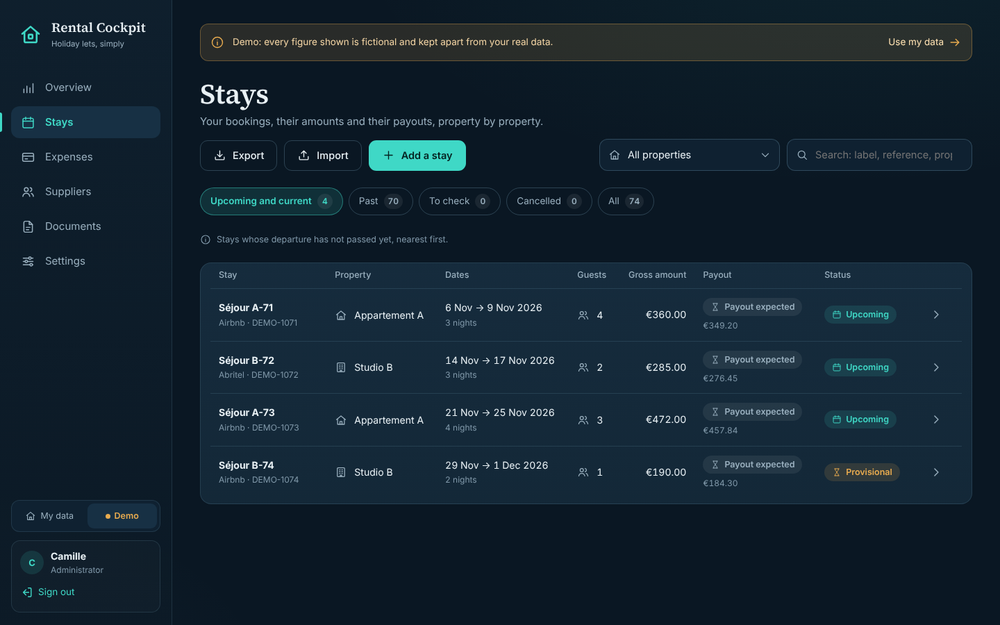

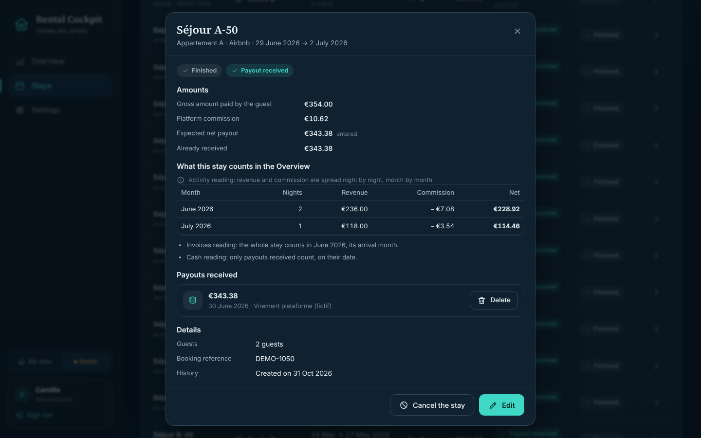

## 9. Import a file

Rather than typing everything, **Stays → Import** (or **Add → A bookings file**):

1. **File**: choose *Airbnb* for the French "Historique des transactions" export, as Airbnb provides it, or *Other CSV file* (Booking.com, Abritel, spreadsheet…), then choose or drop the file.
2. **Check**: nothing is saved yet. For a CSV, check the column chosen for each piece of information against the example shown; state the platform and, when the file has no commission, its rate. Attach each listing of the file to one of your properties. Each line says what will happen:
   - *New*: the stay will be created;
   - *Updated*: a stay already imported changes (the "before → after" detail is shown);
   - *Probable duplicate*: a stay entered by hand has the same dates — by default it is **completed** with what it did not know (reference, commission…), what you typed is kept; you can also create another stay or skip the line;
   - *Up to date*, *No property*, *Error*: nothing will be written, and the reason is given.

   Remarks point at what deserves a look: overlap, unavailable dates, arrival before the activity start, payout already recorded or above what is expected.
3. **Result**: the number of stays created, updated, completed and of payouts recorded. **Undo this import** puts everything back as it was, as long as none of these stays was changed; it can also be done later from **Previous imports**.

Importing the same file again creates nothing twice: everything is *Up to date*. The choices (columns, properties, rate) are remembered for the next file. Guests' names are only taken when you tick the option.

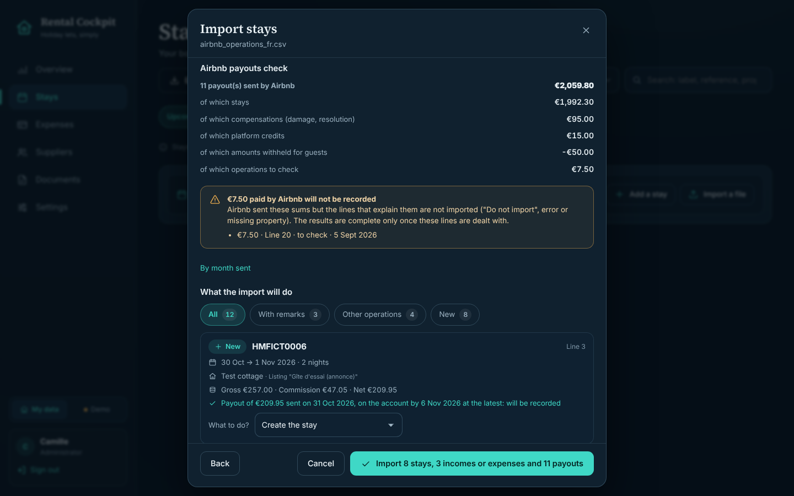

## 10. Enter an expense and pay it

**Expenses → Add an expense** (or **Add → An expense**): choose the property, the category — its treatment shows below it: operations, investment, financing, taxes —, the label, the amount including tax and the invoice date. Then state the **payment**:

- *Already paid*: a payment of the full amount is recorded on the date given;
- *To pay*: the amount counts in "Left to pay";
- *I don't know yet*: the expense shows in **Payment to confirm**. Nothing is assumed paid.

When the money leaves, open the expense, then **Record a payment**: a partial payment is possible, never above what is left. The Cash reading counts each payment on its date.

For a **loan**, choose the *Loan repayment* category, type the principal / interest / insurance breakdown (checked live) and tick **Repeat every month**: one entry per month is created, each one settled on its own. Instalments whose date has not come yet are *Planned*, grouped under "Coming up" and out of "To pay". In the Overview, they count in **Loan repayments**, outside the operating balance.

For an **annual insurance** or a subscription paid in advance, tick **Covers a period**: the Activity reading spreads it day by day.

Income outside stays (refund, occasional rental) is added with **Add income** and follows the same rules, in "To receive".

An entry made by mistake can be **deleted** as long as it has no payment; otherwise **Archive** it: it leaves every total and stays visible. Categories are created, renamed and archived in **Settings → Categories**. **Export** downloads the list shown as CSV, for a spreadsheet or your accountant.

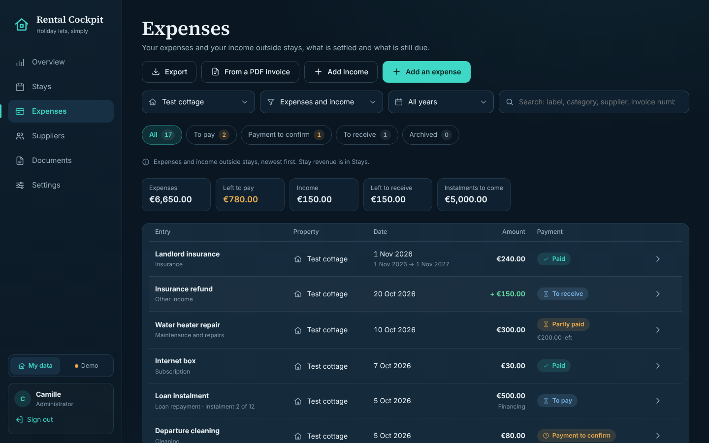

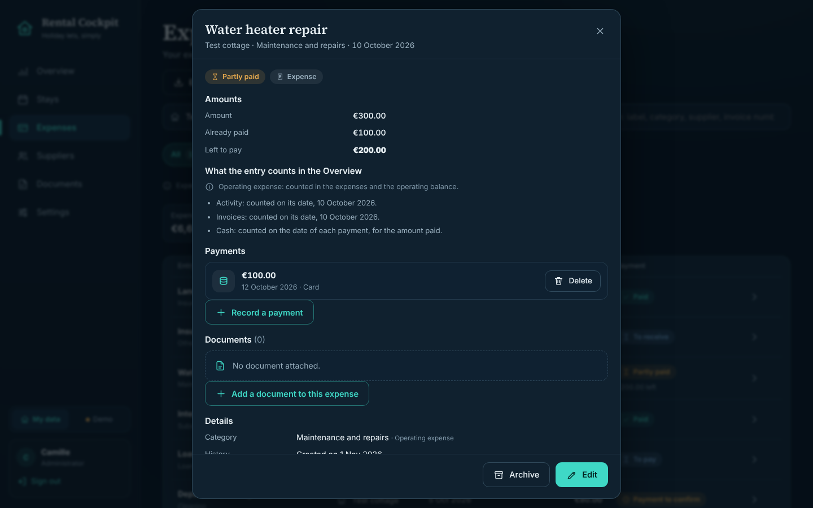

## 11. Suppliers and detailed invoices

**Suppliers → Add a supplier**: name, activity, usual categories (offered first for their invoices), **indicative rates** (cleaning per hour, set of linen…), contact and note. A rate only pre-fills the unit price of a service: it is never applied to an invoice amount.

The supplier's page shows their invoices of the year, what is left to pay, what is left to split, their rates and their recent invoices; **See them in Expenses** opens the full list.

**New invoice** (from the page) opens the expense form with the supplier and their category already chosen. Tick **Break the invoice down into services** and add one line per service: kind (cleaning, linen, travel, other, discount, tax, adjustment), label, quantity, unit, unit price or amount, **date of the work**. The total of the lines is checked live: it must equal the invoice amount, unless an **adjustment** with a mandatory reason makes up the difference. The invoice stays **one single expense**.

On the invoice page, **Split between stays** gives each service to one or more stays of the same property. The stay whose departure falls on the day of the work is offered first (otherwise the stay under way that day). The split is an **analysis**: it adds no expense. An invoice split only in part is flagged in *To check*, with the amount left.

If you had already typed a cleaning by hand after each departure, **Reconcile entries typed by hand** offers the expenses of the same property, of the same kind and in the invoice period. The entries ticked leave the totals and their payments move to the invoice: nothing is counted twice. **Restore the entry** undoes a reconciliation.

Finally, a stay's page shows its **allocated costs** and its **margin after costs** (expected net payout − costs).

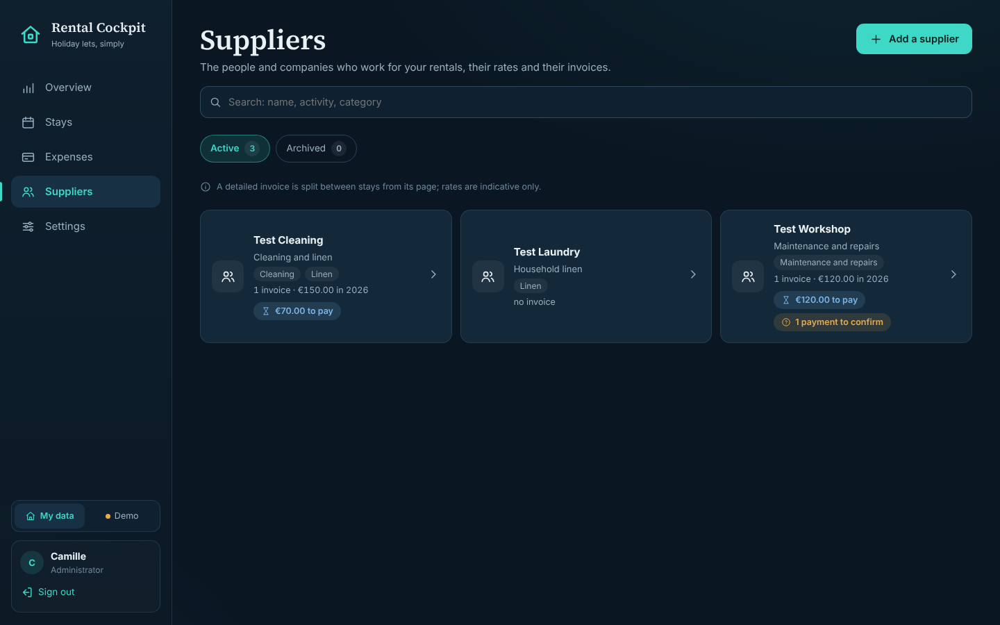

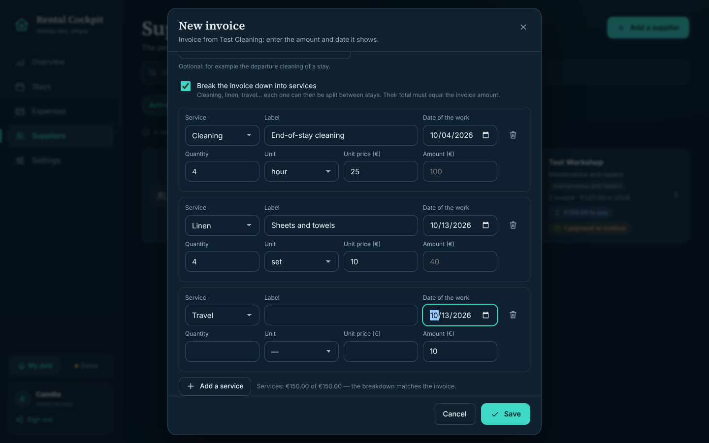

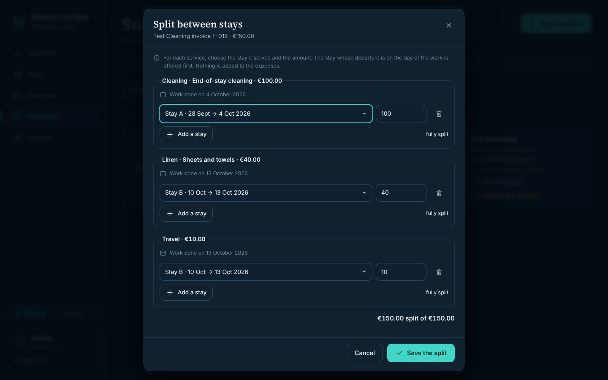

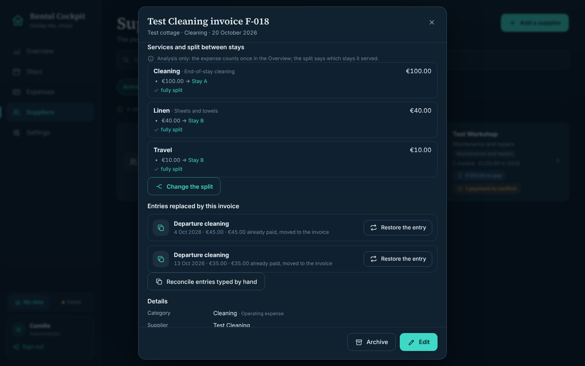

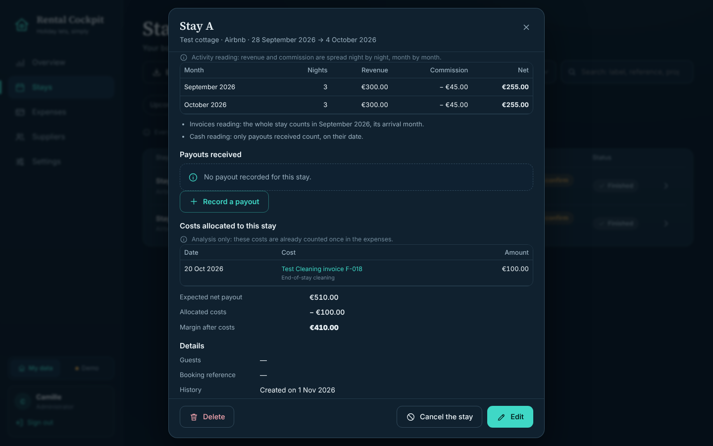

## 12. Protect your account

In **Settings → Two-factor sign-in → Turn on**:

1. confirm your password;
2. scan the QR code with an authenticator app (Aegis, Google Authenticator, 2FAS, Bitwarden…), or type the key by hand, then type the six-digit code shown;
3. store the **ten recovery codes** (copy, download): each one opens a single sign-in if you lose your phone. The window only closes once "I have stored these codes safely" is ticked.

At the next sign-in, the code is asked after the password. The other browsers signed in to this account are signed out.

## 13. Home Assistant (optional)

In **Settings → Home Assistant and API → Create a key**, Rental Cockpit shows once the line to paste into `secrets.yaml`. The address to enter in Home Assistant is shown just above. What comes next (sensors, card, automations): [home-assistant.md](home-assistant.md).

## On a phone

The same Overview shows in one column, balance first, with a navigation bar at the bottom. On touch screens, controls aim at 44 × 44 pixels.

 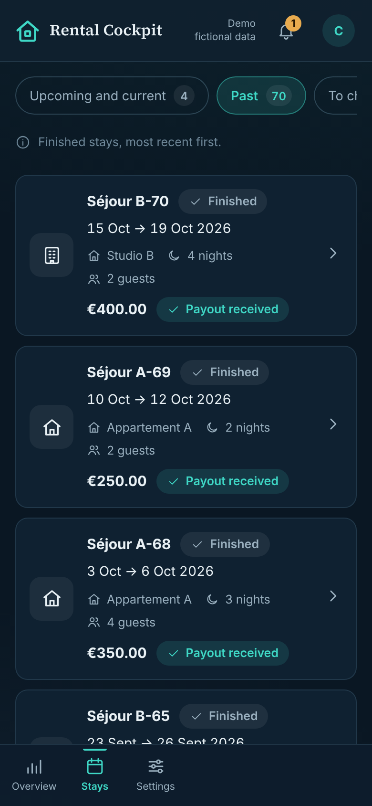 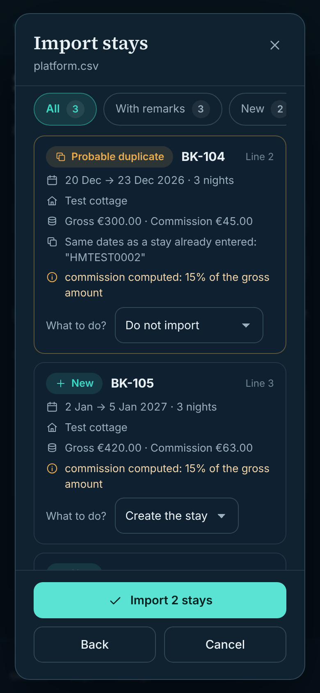 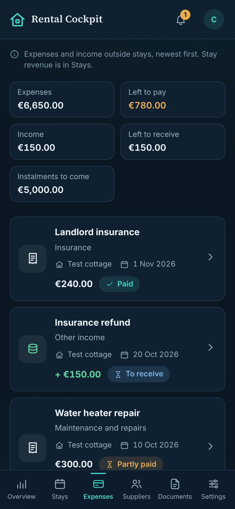 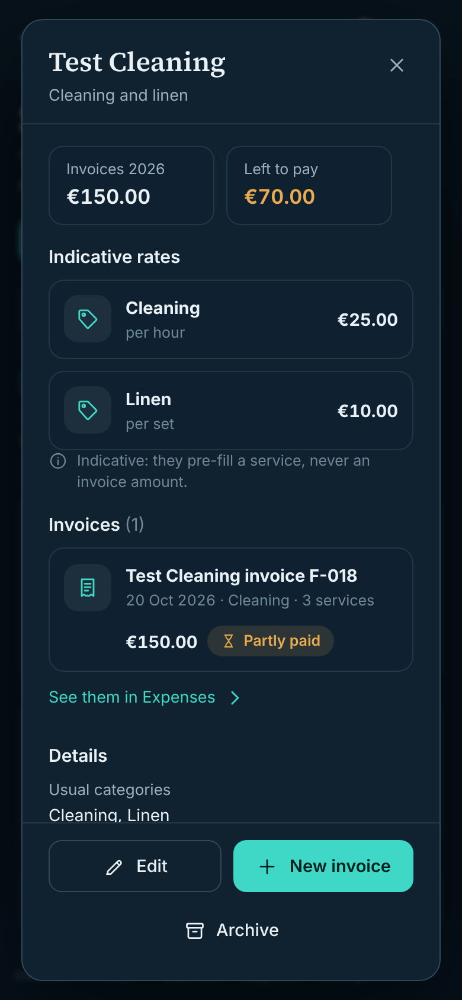 
