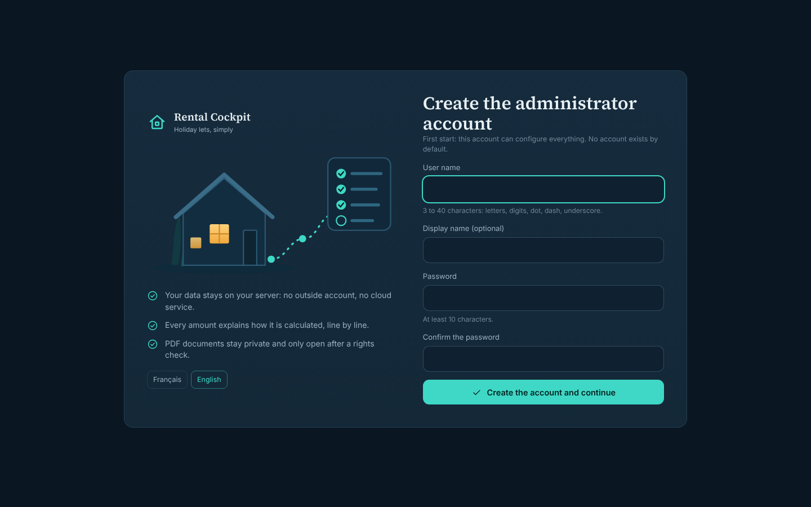
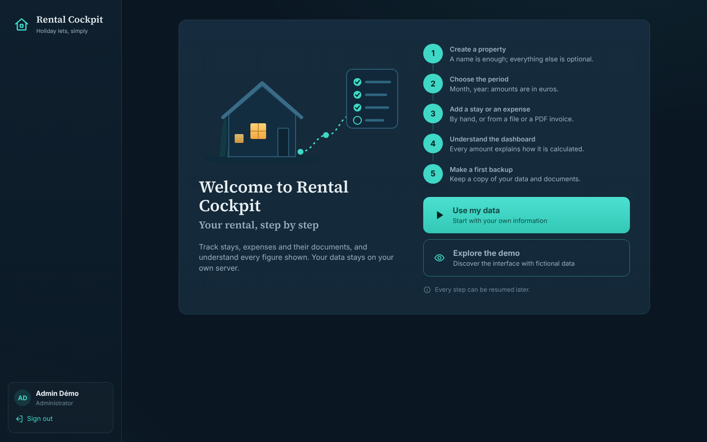
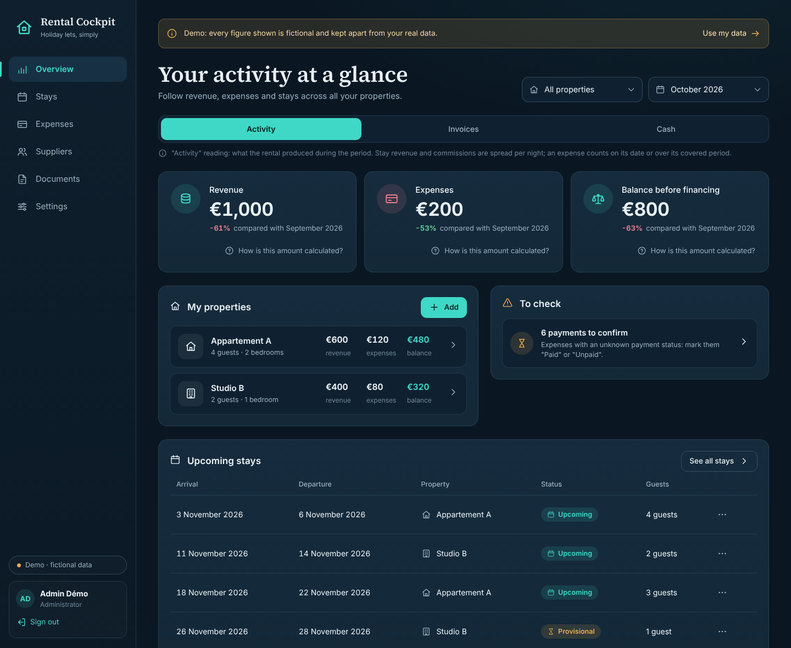
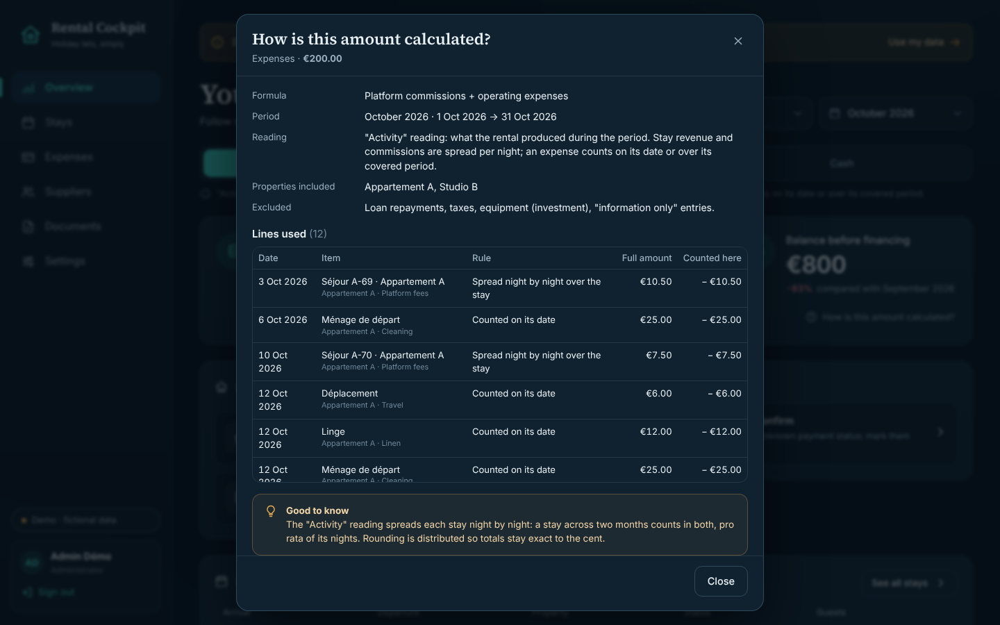
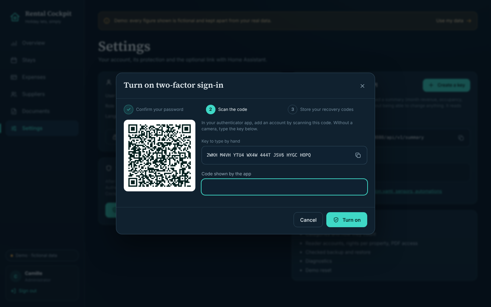
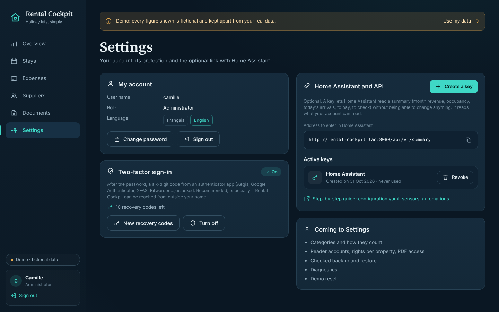
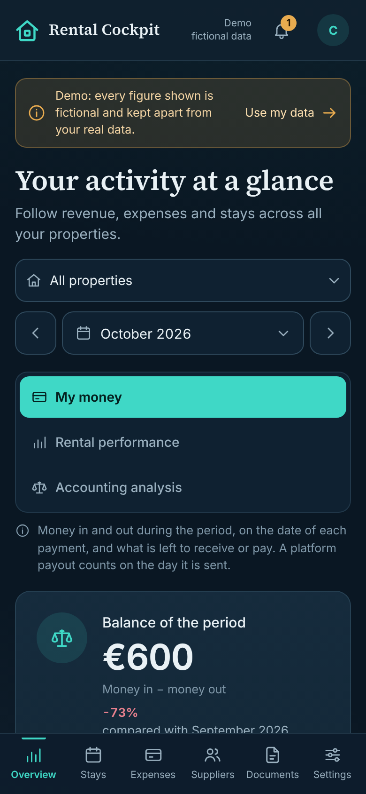
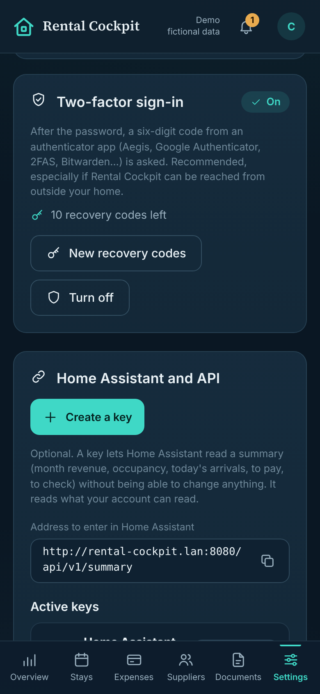

# Getting started — the first ten minutes

This walk-through uses the **demo**: nothing you do here touches your real data.

## 1. Create the administrator account

On first opening, Rental Cockpit asks for a user name and a password (at least 10 characters). This account can configure everything. No account exists by default.

## 2. Choose: your data or the demo

The welcome screen shows the five getting-started steps and two choices:

- **Use my data**: you start empty and create your first property;
- **Explore the demo**: two fictional properties, a year of invented activity.

Every step can be resumed later. Choose the demo.

## 3. Read the Overview

A banner permanently reminds you that the data is fictional. The period offered is the demo's **example month**, which reproduces the documentation example:

- Revenue **€1,000**, Expenses **€200**, Balance before financing **€800**;
- Appartement A: €600 / €120 / €480; Studio B: €400 / €80 / €320.

Under each amount, the percentage compares with the previous month, which is ordinary fictional activity.

## 4. Change the reading

At the top, **Activity / Invoices / Cash** changes the calculation rule, not the data:

- in **Cash**, revenue becomes *money received* (€970: the commission is already deducted);
- the balance before financing stays €800 when everything is paid within the month.

A sentence under the buttons always says what the chosen reading measures.

## 5. Understand an amount

Click **How is this amount calculated?** under the balance. The window shows:

- the equation Revenue − Expenses = Balance;
- the formula, period, reading, properties included and what is excluded;
- **every line used**, with the rule applied to each ("Spread night by night over the stay", "Counted on its date"…) and the total.

## 6. What remains to check

The **To check** card lists what keeps a result from being final. In the demo: cleaning expenses of the previous month whose payment is not confirmed yet.

## 7. Switch to your data

The banner offers **Use my data**. You land on an empty space with the getting-started steps: create your first property (only the name is required). The demo stays available and separate.

## 8. Protect your account

In **Settings → Two-factor sign-in → Turn on**:

1. confirm your password;
2. scan the QR code with an authenticator app (Aegis, Google Authenticator, 2FAS, Bitwarden…), or type the key by hand, then type the six-digit code shown;
3. store the **ten recovery codes** (copy, download): each one opens a single sign-in if you lose your phone. The window only closes once "I have stored these codes safely" is ticked.

At the next sign-in, the code is asked after the password. The other browsers signed in to this account are signed out.

## 9. Home Assistant (optional)

In **Settings → Home Assistant and API → Create a key**, Rental Cockpit shows once the line to paste into `secrets.yaml`. The address to enter in Home Assistant is shown just above. What comes next (sensors, card, automations): [home-assistant.md](home-assistant.md).

## On a phone

The same Overview shows in one column, balance first, with a navigation bar at the bottom. On touch screens, controls aim at 44 × 44 pixels.

 
